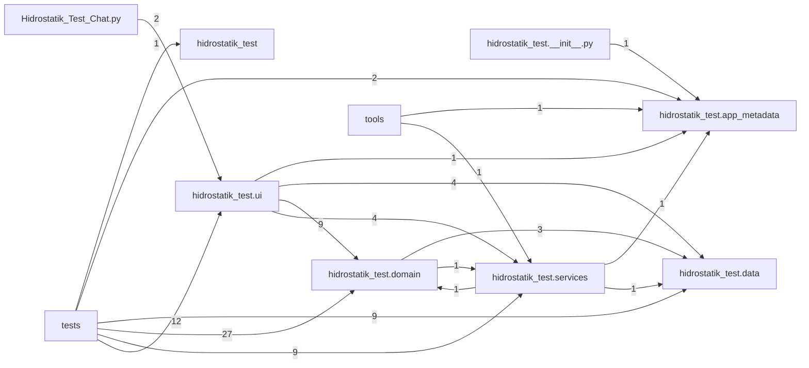

# HYDRO Codebase Map

Bu dosya `skills/graphify` tarafindan uretilmistir. Elle duzenlemeyin;
`python3 skills/graphify/scripts/graphify.py build` ve
`python3 tools/generate_codebase_map.py` komutlarini calistirin.

## Ozet

| Metrik | Deger |
| --- | ---: |
| Dosya | 68 |
| Sembol (sinif + fonksiyon) | 1447 |
| Dugum | 1522 |
| Kenar | 12420 |
| SQLite tablosu | 7 |
| Test edilen kaynak dosya | 28 / 29 |

## Paket Bagimliliklari

| Kaynak paket | Hedef paket | Import sayisi |
| --- | --- | ---: |
| `tests` | `hidrostatik_test.domain` | 27 |
| `tests` | `hidrostatik_test.ui` | 12 |
| `hidrostatik_test.ui` | `hidrostatik_test.domain` | 9 |
| `tests` | `hidrostatik_test.data` | 9 |
| `tests` | `hidrostatik_test.services` | 9 |
| `hidrostatik_test.ui` | `hidrostatik_test.data` | 4 |
| `hidrostatik_test.ui` | `hidrostatik_test.services` | 4 |
| `hidrostatik_test.domain` | `hidrostatik_test.data` | 3 |
| `Hidrostatik_Test_Chat.py` | `hidrostatik_test.ui` | 2 |
| `tests` | `hidrostatik_test.app_metadata` | 2 |
| `hidrostatik_test.__init__.py` | `hidrostatik_test.app_metadata` | 1 |
| `hidrostatik_test.domain` | `hidrostatik_test.services` | 1 |
| `hidrostatik_test.services` | `hidrostatik_test.app_metadata` | 1 |
| `hidrostatik_test.services` | `hidrostatik_test.data` | 1 |
| `hidrostatik_test.services` | `hidrostatik_test.domain` | 1 |
| `hidrostatik_test.ui` | `hidrostatik_test.app_metadata` | 1 |
| `tests` | `hidrostatik_test` | 1 |
| `tools` | `hidrostatik_test.app_metadata` | 1 |
| `tools` | `hidrostatik_test.services` | 1 |

## En Buyuk Dosyalar (sembol sayisina gore)

| Dosya | Sinif | Fonksiyon | Toplam |
| --- | ---: | ---: | ---: |
| `hidrostatik_test/ui/app.py` | 1 | 262 | 263 |
| `tests/test_updater.py` | 8 | 93 | 101 |
| `tests/test_ui_workflow.py` | 2 | 98 | 100 |
| `tests/test_wizard.py` | 14 | 55 | 69 |
| `tests/test_validators.py` | 6 | 60 | 66 |
| `hidrostatik_test/services/updater.py` | 4 | 48 | 52 |
| `tests/test_water_properties.py` | 5 | 38 | 43 |
| `hidrostatik_test/ui/wizard.py` | 2 | 40 | 42 |
| `tests/test_time_series.py` | 3 | 34 | 37 |
| `tests/test_session_manager.py` | 5 | 31 | 36 |
| `tests/test_hydrotest_core.py` | 6 | 29 | 35 |
| `tests/test_coefficient_manager.py` | 2 | 32 | 34 |
| `tests/test_download_dialog.py` | 4 | 29 | 33 |
| `hidrostatik_test/domain/session_manager.py` | 2 | 30 | 32 |
| `hidrostatik_test/services/download_manager.py` | 4 | 24 | 28 |
| `hidrostatik_test/data/ab_control_table.py` | 8 | 19 | 27 |
| `hidrostatik_test/domain/water_properties.py` | 6 | 21 | 27 |
| `hidrostatik_test/ui/download_dialog.py` | 1 | 24 | 25 |
| `tests/test_download_manager.py` | 4 | 18 | 22 |
| `tests/test_database.py` | 1 | 19 | 20 |

## Test Haritasi

| Kaynak dosya | Bagli test dosyalari |
| --- | --- |
| `hidrostatik_test/__init__.py` | `tests/test_download_dialog.py`, `tests/test_session_manager.py`, `tests/test_ui_workflow.py`, `tests/test_updater.py`, `tests/test_wizard.py` |
| `hidrostatik_test/app_metadata.py` | `tests/test_app_metadata.py`, `tests/test_ui_workflow.py`, `tests/test_updater.py` |
| `hidrostatik_test/data/__init__.py` | `tests/test_download_dialog.py`, `tests/test_session_manager.py`, `tests/test_ui_workflow.py`, `tests/test_updater.py`, `tests/test_wizard.py` |
| `hidrostatik_test/data/ab_control_table.py` | `tests/test_ab_control_table.py` |
| `hidrostatik_test/data/botas_reference_table.py` | `tests/test_botas_reference_table.py` |
| `hidrostatik_test/data/coefficient_reference.py` | `tests/test_coefficient_reference.py` |
| `hidrostatik_test/data/gail_reference_table.py` | `tests/test_gail_reference_table.py` |
| `hidrostatik_test/data/pipe_catalog.py` | `tests/test_pipe_catalog.py` |
| `hidrostatik_test/data/water_property_table.py` | `tests/test_water_property_table.py` |
| `hidrostatik_test/domain/__init__.py` | `tests/test_download_dialog.py`, `tests/test_session_manager.py`, `tests/test_ui_workflow.py`, `tests/test_updater.py`, `tests/test_wizard.py` |
| `hidrostatik_test/domain/coefficient_manager.py` | `tests/test_coefficient_manager.py`, `tests/test_e2e_workflow.py`, `tests/test_ui_workflow.py` |
| `hidrostatik_test/domain/coefficient_sources.py` | `tests/test_coefficient_sources.py` |
| `hidrostatik_test/domain/hydrotest_core.py` | `tests/test_coefficient_sources.py`, `tests/test_e2e_workflow.py`, `tests/test_hydrotest_core.py`, `tests/test_ui_workflow.py` |
| `hidrostatik_test/domain/operations.py` | `tests/test_operations.py`, `tests/test_time_series.py` |
| `hidrostatik_test/domain/pressure_profile.py` | `tests/test_pressure_profile.py` |
| `hidrostatik_test/domain/pressurization.py` | `tests/test_pressurization.py` |
| `hidrostatik_test/domain/session_manager.py` | `tests/test_e2e_workflow.py`, `tests/test_session_manager.py`, `tests/test_ui_workflow.py`, `tests/test_wizard.py` |
| `hidrostatik_test/domain/time_series.py` | `tests/test_database.py`, `tests/test_e2e_workflow.py`, `tests/test_session_manager.py`, `tests/test_time_series.py`, `tests/test_ui_workflow.py` |
| `hidrostatik_test/domain/units.py` | `tests/test_download_dialog.py`, `tests/test_ui_helpers.py`, `tests/test_units.py` |
| `hidrostatik_test/domain/water_properties.py` | `tests/test_hydrotest_core.py`, `tests/test_water_properties.py` |
| `hidrostatik_test/services/__init__.py` | `tests/test_download_dialog.py`, `tests/test_session_manager.py`, `tests/test_ui_workflow.py`, `tests/test_updater.py`, `tests/test_wizard.py` |
| `hidrostatik_test/services/database.py` | `tests/test_database.py`, `tests/test_session_manager.py`, `tests/test_ui_workflow.py` |
| `hidrostatik_test/services/download_manager.py` | `tests/test_download_dialog.py`, `tests/test_download_manager.py`, `tests/test_ui_workflow.py`, `tests/test_updater.py` |
| `hidrostatik_test/services/report_export.py` | `tests/test_report_export.py`, `tests/test_ui_workflow.py` |
| `hidrostatik_test/services/updater.py` | `tests/test_e2e_workflow.py`, `tests/test_updater.py` |
| `hidrostatik_test/services/water_property_table_builder.py` | `tests/test_water_property_table.py` |
| `hidrostatik_test/ui/__init__.py` | `tests/test_download_dialog.py`, `tests/test_session_manager.py`, `tests/test_ui_workflow.py`, `tests/test_updater.py`, `tests/test_wizard.py` |
| `hidrostatik_test/ui/app.py` | `tests/test_app_metadata.py`, `tests/test_database.py`, `tests/test_download_dialog.py`, `tests/test_download_manager.py`, `tests/test_e2e_workflow.py`, `tests/test_ui_helpers.py`, `tests/test_ui_workflow.py`, `tests/test_updater.py`, `tests/test_wizard.py` |
| `hidrostatik_test/ui/constants.py` | `tests/test_botas_reference_table.py`, `tests/test_constants.py`, `tests/test_e2e_workflow.py`, `tests/test_ui_workflow.py` |
| `hidrostatik_test/ui/download_dialog.py` | `tests/test_download_dialog.py`, `tests/test_ui_workflow.py` |
| `hidrostatik_test/ui/helpers.py` | `tests/test_ui_helpers.py` |
| `hidrostatik_test/ui/validators.py` | `tests/test_validators.py` |
| `hidrostatik_test/ui/wizard.py` | `tests/test_database.py`, `tests/test_session_manager.py`, `tests/test_wizard.py` |

### Dogrudan test eslesmesi olmayan kaynak dosyalar

- `hidrostatik_test/_pyinstaller_hook.py`

## Cagri Grafigi Odaklari

| Sembol | Cagri noktasi | Ornek cagiranlar |
| --- | ---: | --- |
| `assertEqual` | 288 | `tests/test_ab_control_table.py:test_default_load_keeps_permissive_behaviour`, `tests/test_ab_control_table.py:test_excessive_adjacent_jump_is_reported`, `tests/test_ab_control_table.py:test_known_seven_degree_anomaly_is_reported` (+285) |
| `get` | 270 | `docs/legacy/Hidrostatik_Test_Chat_v0.py:calculate_A`, `docs/legacy/Hidrostatik_Test_Chat_v0.py:run_air_content_test`, `docs/legacy/Hidrostatik_Test_Chat_v0.py:run_pressure_test` (+267) |
| `set` | 191 | `hidrostatik_test/_pyinstaller_hook.py:_setup_numpy_dll_paths`, `hidrostatik_test/data/ab_control_table.py:_load_ab_control_repair_grid`, `hidrostatik_test/services/download_manager.py:cancel` (+188) |
| `assertTrue` | 155 | `tests/test_ab_control_table.py:test_duplicate_grid_node_is_reported`, `tests/test_ab_control_table.py:test_exact_grid_node_matches_imported_workbook_value`, `tests/test_ab_control_table.py:test_known_seven_degree_anomaly_is_reported` (+152) |
| `str` | 113 | `hidrostatik_test/data/ab_control_table.py:_axis_from_metadata`, `hidrostatik_test/data/ab_control_table.py:_spec_from_metadata`, `hidrostatik_test/data/ab_control_table.py:load_ab_control_table` (+110) |
| `assertIn` | 110 | `tests/test_ab_control_table.py:test_exact_grid_node_matches_imported_workbook_value`, `tests/test_ab_control_table.py:test_midpoint_uses_bilinear_interpolation`, `tests/test_ab_control_table.py:test_seven_degree_anomaly_is_repaired_at_runtime` (+107) |
| `Path` | 99 | `hidrostatik_test/data/ab_control_table.py:count_repaired_ab_control_points`, `hidrostatik_test/data/ab_control_table.py:find_ab_control_table_issues`, `hidrostatik_test/data/ab_control_table.py:load_ab_control_table` (+96) |
| `len` | 88 | `hidrostatik_test/data/ab_control_table.py:__init__`, `hidrostatik_test/data/ab_control_table.py:_axis_bounds`, `hidrostatik_test/data/ab_control_table.py:_axis_index_or_none` (+85) |
| `assertFalse` | 86 | `tests/test_ab_control_table.py:test_known_seven_degree_anomaly_is_reported`, `tests/test_ab_control_table.py:test_runtime_repair_keeps_healthy_lookups_unchanged`, `tests/test_ab_control_table.py:test_small_table_anomaly_is_repaired_by_row_interpolation` (+83) |
| `strip` | 82 | `hidrostatik_test/data/botas_reference_table.py:is_botas_reference_option`, `hidrostatik_test/data/coefficient_reference.py:find_reference_point`, `hidrostatik_test/data/gail_reference_table.py:is_gail_reference_option` (+79) |
| `append` | 71 | `hidrostatik_test/_pyinstaller_hook.py:_setup_numpy_dll_paths`, `hidrostatik_test/data/ab_control_table.py:find_ab_control_table_issues`, `hidrostatik_test/domain/session_manager.py:_load_session_from_db` (+68) |
| `TemporaryDirectory` | 56 | `tests/test_ab_control_table.py:test_duplicate_grid_node_is_reported`, `tests/test_ab_control_table.py:test_excessive_adjacent_jump_is_reported`, `tests/test_ab_control_table.py:test_missing_grid_node_is_reported` (+53) |
| `assertRaises` | 55 | `tests/test_ab_control_table.py:test_out_of_range_lookup_raises_error`, `tests/test_ab_control_table.py:test_validate_flag_raises_with_attached_issues`, `tests/test_botas_reference_table.py:test_botas_rejects_26c_while_gail_still_serves_it` (+52) |
| `patch` | 54 | `tests/test_download_dialog.py:test_cancel_declined_keeps_download_running`, `tests/test_download_dialog.py:test_cancel_while_running_asks_once`, `tests/test_download_dialog.py:test_close_while_running_asks_and_cancels` (+51) |
| `isclose` | 53 | `tests/test_ab_control_table.py:test_exact_grid_node_matches_imported_workbook_value`, `tests/test_ab_control_table.py:test_known_seven_degree_anomaly_is_reported`, `tests/test_ab_control_table.py:test_midpoint_uses_bilinear_interpolation` (+50) |
| `float` | 51 | `docs/legacy/Hidrostatik_Test_Chat_v0.py:calculate_A`, `docs/legacy/Hidrostatik_Test_Chat_v0.py:run_air_content_test`, `docs/legacy/Hidrostatik_Test_Chat_v0.py:run_pressure_test` (+48) |
| `_set_banner` | 45 | `hidrostatik_test/ui/app.py:_add_geometry_segment`, `hidrostatik_test/ui/app.py:_add_time_series_record`, `hidrostatik_test/ui/app.py:_apply_air_a_reference` (+42) |
| `join` | 44 | `hidrostatik_test/_pyinstaller_hook.py:_setup_numpy_dll_paths`, `hidrostatik_test/domain/coefficient_sources.py:normalize_b_source`, `hidrostatik_test/domain/hydrotest_core.py:normalize_steel_model` (+41) |
| `exists` | 38 | `hidrostatik_test/data/ab_control_table.py:find_ab_control_table_issues`, `hidrostatik_test/data/ab_control_table.py:load_ab_control_table`, `hidrostatik_test/data/water_property_table.py:load_water_property_table` (+35) |
| `assertIsNotNone` | 36 | `tests/test_database.py:test_timestamps_are_utc_iso8601`, `tests/test_download_manager.py:test_get_task_returns_detached_copy`, `tests/test_e2e_workflow.py:test_session_persistence_with_sqlite` (+33) |
| `configure` | 34 | `hidrostatik_test/ui/app.py:_append_result`, `hidrostatik_test/ui/app.py:_apply_b_helper_mode`, `hidrostatik_test/ui/app.py:_apply_field_visual_state` (+31) |
| `items` | 33 | `hidrostatik_test/domain/coefficient_manager.py:as_dict`, `hidrostatik_test/domain/coefficient_manager.py:from_dict`, `hidrostatik_test/domain/session_manager.py:from_dict` (+30) |
| `_safe_float` | 33 | `hidrostatik_test/ui/app.py:_active_monitored_pressure_bar`, `hidrostatik_test/ui/app.py:_add_time_series_record`, `hidrostatik_test/ui/app.py:_build_air_control_table_summary` (+30) |
| `getattr` | 32 | `hidrostatik_test/_pyinstaller_hook.py:_setup_numpy_dll_paths`, `hidrostatik_test/services/download_manager.py:_content_length`, `hidrostatik_test/services/download_manager.py:_do_download` (+29) |
| `write_bytes` | 32 | `tests/test_download_manager.py:test_partial_file_is_restarted_when_server_ignores_range`, `tests/test_updater.py:fake_download`, `tests/test_updater.py:test_allow_unsigned_env_flag_tolerates_missing_signature` (+29) |
| `assertIsNone` | 29 | `tests/test_coefficient_reference.py:test_lookup_accepts_exact_labels_only`, `tests/test_database.py:test_delete_session_cascades`, `tests/test_download_dialog.py:test_cancel_declined_keeps_download_running` (+26) |
| `isinstance` | 29 | `hidrostatik_test/data/ab_control_table.py:_axis_from_metadata`, `hidrostatik_test/data/ab_control_table.py:_spec_from_metadata`, `hidrostatik_test/data/pipe_catalog.py:_item_schedules` (+26) |
| `ValidationError` | 28 | `hidrostatik_test/domain/coefficient_sources.py:_validate_state`, `hidrostatik_test/domain/coefficient_sources.py:_validate_steel_alpha`, `hidrostatik_test/domain/coefficient_sources.py:normalize_b_source` (+25) |
| `FakeApp` | 27 | `tests/test_wizard.py:test_air_only_parameters_are_accepted`, `tests/test_wizard.py:test_auto_b_must_be_ready`, `tests/test_wizard.py:test_empty_manual_geometry_is_blocked` (+24) |
| `make_controller` | 27 | `tests/test_wizard.py:test_air_only_parameters_are_accepted`, `tests/test_wizard.py:test_auto_b_must_be_ready`, `tests/test_wizard.py:test_empty_manual_geometry_is_blocked` (+24) |

## Kritik Dosyalarin Etki Alani

### `hidrostatik_test/domain/hydrotest_core.py`

- Bagli testler: `tests/test_coefficient_sources.py`, `tests/test_e2e_workflow.py`, `tests/test_hydrotest_core.py`, `tests/test_ui_workflow.py`
- Etkilenen dosyalar (10): `hidrostatik_test/domain/__init__.py`, `hidrostatik_test/domain/coefficient_sources.py`, `hidrostatik_test/domain/operations.py`, `hidrostatik_test/domain/pressure_profile.py`, `hidrostatik_test/domain/pressurization.py`, `hidrostatik_test/ui/app.py`, `tests/test_coefficient_sources.py`, `tests/test_e2e_workflow.py`, `tests/test_hydrotest_core.py`, `tests/test_ui_workflow.py`

### `hidrostatik_test/domain/water_properties.py`

- Bagli testler: `tests/test_hydrotest_core.py`, `tests/test_water_properties.py`
- Etkilenen dosyalar (8): `hidrostatik_test/domain/__init__.py`, `hidrostatik_test/domain/coefficient_sources.py`, `hidrostatik_test/domain/hydrotest_core.py`, `hidrostatik_test/domain/pressure_profile.py`, `hidrostatik_test/services/water_property_table_builder.py`, `hidrostatik_test/ui/app.py`, `tests/test_hydrotest_core.py`, `tests/test_water_properties.py`

### `hidrostatik_test/domain/time_series.py`

- Bagli testler: `tests/test_database.py`, `tests/test_e2e_workflow.py`, `tests/test_session_manager.py`, `tests/test_time_series.py`, `tests/test_ui_workflow.py`
- Etkilenen dosyalar (3): `hidrostatik_test/domain/session_manager.py`, `hidrostatik_test/ui/app.py`, `tests/test_time_series.py`

### `hidrostatik_test/services/updater.py`

- Bagli testler: `tests/test_e2e_workflow.py`, `tests/test_updater.py`
- Etkilenen dosyalar (4): `hidrostatik_test/services/__init__.py`, `hidrostatik_test/ui/app.py`, `tests/test_e2e_workflow.py`, `tests/test_updater.py`

### `hidrostatik_test/services/download_manager.py`

- Bagli testler: `tests/test_download_dialog.py`, `tests/test_download_manager.py`, `tests/test_ui_workflow.py`, `tests/test_updater.py`
- Etkilenen dosyalar (6): `hidrostatik_test/services/updater.py`, `hidrostatik_test/ui/app.py`, `hidrostatik_test/ui/download_dialog.py`, `tests/test_download_dialog.py`, `tests/test_download_manager.py`, `tests/test_ui_workflow.py`

### `hidrostatik_test/services/database.py`

- Bagli testler: `tests/test_database.py`, `tests/test_session_manager.py`, `tests/test_ui_workflow.py`
- Etkilenen dosyalar (2): `hidrostatik_test/domain/session_manager.py`, `tests/test_database.py`

### `hidrostatik_test/services/report_export.py`

- Bagli testler: `tests/test_report_export.py`, `tests/test_ui_workflow.py`
- Etkilenen dosyalar (2): `hidrostatik_test/ui/app.py`, `tests/test_report_export.py`

### `hidrostatik_test/ui/app.py`

- Bagli testler: `tests/test_app_metadata.py`, `tests/test_database.py`, `tests/test_download_dialog.py`, `tests/test_download_manager.py`, `tests/test_e2e_workflow.py`, `tests/test_ui_helpers.py`, `tests/test_ui_workflow.py`, `tests/test_updater.py`, `tests/test_wizard.py`
- Etkilenen dosyalar (5): `Hidrostatik_Test_Chat.py`, `hidrostatik_test/ui/__init__.py`, `tests/test_e2e_workflow.py`, `tests/test_ui_workflow.py`, `tests/test_updater.py`

## Veritabani Tablolari

| Tablo | Kullanan moduller |
| --- | --- |
| `IF` | `hidrostatik_test/_pyinstaller_hook.py`, `hidrostatik_test/data/ab_control_table.py`, `hidrostatik_test/data/botas_reference_table.py`, `hidrostatik_test/data/coefficient_reference.py`, `hidrostatik_test/data/gail_reference_table.py`, `hidrostatik_test/data/pipe_catalog.py`, `hidrostatik_test/data/water_property_table.py`, `hidrostatik_test/domain/coefficient_manager.py`, `hidrostatik_test/domain/coefficient_sources.py`, `hidrostatik_test/domain/hydrotest_core.py`, `hidrostatik_test/domain/operations.py`, `hidrostatik_test/domain/pressure_profile.py`, `hidrostatik_test/domain/pressurization.py`, `hidrostatik_test/domain/session_manager.py`, `hidrostatik_test/domain/time_series.py`, `hidrostatik_test/domain/water_properties.py`, `hidrostatik_test/services/database.py`, `hidrostatik_test/services/download_manager.py`, `hidrostatik_test/services/report_export.py`, `hidrostatik_test/services/updater.py`, `hidrostatik_test/ui/app.py`, `hidrostatik_test/ui/download_dialog.py`, `hidrostatik_test/ui/helpers.py`, `hidrostatik_test/ui/validators.py`, `hidrostatik_test/ui/wizard.py` |
| `coefficients` | `hidrostatik_test/services/database.py` |
| `geometry_records` | `hidrostatik_test/services/database.py` |
| `schema_version` | `hidrostatik_test/data/ab_control_table.py`, `hidrostatik_test/data/water_property_table.py`, `hidrostatik_test/services/database.py`, `hidrostatik_test/services/water_property_table_builder.py`, `hidrostatik_test/ui/app.py` |
| `sessions` | `hidrostatik_test/domain/session_manager.py`, `hidrostatik_test/services/database.py`, `hidrostatik_test/ui/app.py` |
| `test_entries` | `hidrostatik_test/services/database.py` |
| `time_series_records` | `hidrostatik_test/domain/session_manager.py`, `hidrostatik_test/services/database.py`, `hidrostatik_test/ui/app.py` |

## Mermaid: Paket Bagimliligi

