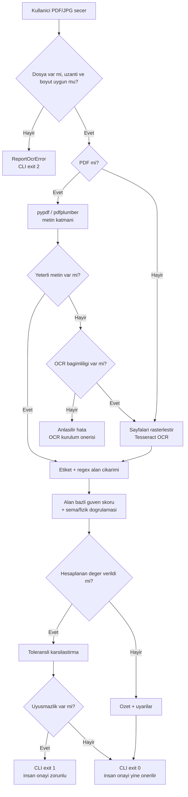

# OCR Tabanli Test Raporu Okuma ve Karsilastirma Altyapisi

**Durum:** Servis + UI entegrasyonu tamamlandi (`Rapor > Test Raporu Kontrol (OCR)...`).
**Kapsam:** Yuklenen hidrostatik test raporlarindan (PDF/gorsel) alan
cikarma, guven skoru, insan onayi ve uygulamanin hesapladigi degerlerle
toleransli karsilastirma.
**Ilgili dosyalar:**

- `hidrostatik_test/domain/report_schema.py` - veri semasi ve birim
  normalizasyonu
- `hidrostatik_test/services/report_ocr.py` - metin/OCR cikarimi, alan
  ayristirma, karsilastirma
- `tools/ocr_report.py` - komut satiri araci
- `tests/test_report_ocr.py` - birim ve uctan uca testler
- `requirements-ocr.txt` - opsiyonel OCR bagimliliklari

---

## 1. Amac

Saha ekibi, test sonrasinda doldurulmus formu PDF veya telefon/scanner
goruntusu olarak yukler. Uygulama:

1. Belgeden metni ve alanlari okur.
2. Her alan icin bir guven skoru ve ham metin kaynagi tutar.
3. Ayni test icin uygulamanin hesapladigi `Vp`, `Vpa`, `dT`, `Pa`, `A`,
   `B` ve kabul sonucu ile karsilastirir.
4. Uyusmazliklari onem derecesine gore raporlar.
5. Hicbir alani sessizce "dogru" kabul etmez; supheli alanlari insan
   onayina sunar.

Bu fazda hedef, resmi kabul akisini otomatiklestirmek degil; **denetlenebilir
bir on-kontrol ve mutabakat katmani** kurmaktir. Nihai kabul karari her
zaman yetkili personel tarafindan verilir.

---

## 2. Mimari Karar

### 2.1 Katmanli okuma: once gomulu metin, sonra OCR

```text
PDF -> pypdf/pdfplumber metin katmani -> yeterliyse -> alan cikarimi
                                 |
                                 +-- yetersizse -> raster -> Tesseract -> alan cikarimi
Gorsel (JPG/PNG/TIFF) -> raster -> Tesseract -> alan cikarimi
```

Gerekce:

- Kurumsal test formlarinin onemli bir kismi bilgisayarda uretilip PDF
  olarak imzalanir. Bu belgelerde metin katmani **kayipsiz** ve hizlidir;
  OCR'a hic gerek yoktur.
- Taranmis veya telefonla cekilmis belgelerde metin katmani yoktur; OCR
  tek secenektir.
- OCR yalnizca gerektiginde calisir. Bu, hizi ve hata yuzeyini azaltir.

### 2.2 PDF metin cikarimi

| Arac | Lisans | Guclu yon | Zayif yon | Karar |
|---|---|---|---|---|
| `pypdf` | BSD-3-Clause | Saf Python, kucuk paket, hizli metin katmani, sifreli PDF tespiti | Tablo yapisi cikarmaz | **Birincil** |
| `pdfplumber` | MIT | Daha iyi kelime/konum ve tablo cikarimi (`pdfminer.six` tabanli) | Daha yavas, daha buyuk bagimlilik | **Yedek / tablo iyilestirmesi** |

Ikisi de yalnizca gomulu metni okur; taranmis PDF'te metin uretmez.

### 2.3 OCR motorlari

| Motor | Lisans | Paket/dağıtım boyutu | Turkce | Tablo | Offline | Windows/macOS | Degerlendirme |
|---|---|---|---|---|---|---|---|
| **Tesseract** (`pytesseract`) | Apache-2.0 | Tesseract ~30-100 MB + dil paketleri; `pytesseract` ~50 KB | `tur` traineddata ile iyi; `eng` ile idare eder | Zayif; satir bazli okur, tablo yapisi vermez | Evet | Windows'ta UB Mannheim kurulumu, macOS'ta Homebrew; harici binary gerekir | **Varsayilan opsiyonel motor** |
| **PaddleOCR** | Apache-2.0 | PaddlePaddle + modeller ~400 MB-1 GB+ | Model kapsami surumle dogrulanmali | PP-Structure ile tablo destegi var | Evet (modeller indirildikten sonra) | PyInstaller ile paketlemesi zahmetli | Gelecek fazda degerlendirme |
| **EasyOCR** | Apache-2.0 | PyTorch ile birlikte ~1-2 GB | `tr` destegi var | Yok; layout sonradan kurulmalidir | Ilk model indirmesi haric evet | Paket boyutu ve GPU/CPU dagitimi zor | Bu fazda onerilmez |
| Bulut OCR (Google/Azure) | Ticari | Kucuk istemci | Cok iyi | Degisken | **Hayir** | Kolay | KVKK/veri gizliligi nedeniyle **reddedildi** |

**Karar:** Bu fazda Tesseract opsiyonel motor olarak baglanir; PaddleOCR ve
EasyOCR ayni `_run_tesseract` benzeri arayuzun arkasina sonradan eklenebilir.
Bulut OCR kurumsal veri gizliligi politikasi nedeniyle kapsam disidir.

### 2.4 Alan cikarimi: etiket + regex, sablon esleme degil

- Form numaralari (BOT-FRM-CDB-001-015/020/021/022) ve revizyonlari
  degisebilir. Sabit koordinatli sablonlar kirilgandir.
- Bu nedenle etiket sozlugu (`FIELD_ALIASES`) ve regex tabanli deger
  ayristirma kullanilir. Turkce/Ingilizce etiketler, ondalik virgul, binlik
  ayirici, tarih formatlari ve birim ekleri desteklenir.
- Ayni deger birden fazla yerde geciyorsa en yuksek guvenli aday secilir ve
  celiski uyari olarak raporlanir.

---

## 3. Akis Diyagrami



---

## 4. Desteklenen Formatlar ve Sinirlar

| Oge | Deger |
|---|---|
| PDF | Gomulu metin katmani; taranmis PDF'ler opsiyonel OCR ile |
| Gorsel | `.png`, `.jpg`, `.jpeg`, `.tif`, `.tiff`, `.bmp`, `.webp` |
| Maksimum dosya boyutu | 25 MB |
| Maksimum PDF sayfasi (metin) | 200 |
| OCR'a verilen maksimum sayfa | 30 |
| Desteklenmeyen | `.docx`, `.xlsx`, elle yazilmis notlar, imza/stamp dogrulama |
| Sifreli PDF | Sifre girilmeden reddedilir (`encrypted_pdf`) |
| Bos metin / okunaksiz goruntu | `empty_text` / `corrupt_image` |

Buyuk dosya, sifreli PDF, bozuk goruntu, desteklenmeyen uzanti ve bos metin
durumlari `ReportOcrError` icinde **kodlu ve kullaniciya gosterilebilir**
mesajlarla yonetilir.

---

## 5. Alan Semasi

Her alan `ExtractedField` olarak saklanir:

| Alt alan | Tip | Aciklama |
|---|---|---|
| `value` | `float \| str \| None` | Kanonik birimde deger veya metin |
| `unit` | `str` | Kanonik birim (`bar`, `°C`, `mm`, `m`, `m³`, `10^-6/bar`, `10^-6/°C`) |
| `confidence` | `0.0-1.0` | Okuma guveni |
| `raw_text` | `str` | Etiketten sonraki ham metin |
| `page` | `int \| None` | 1 tabanli sayfa numarasi |
| `bbox` | `tuple \| None` | Gelecekte kelime kutusu (su an `None`) |

`HydrotestReport` alanlari:

| Anahtar | Etiket | Birim | Zorunlu | Kaynak |
|---|---|---|---|---|
| `report_no` | Rapor No | - | Hayir | Form basligi |
| `date` | Tarih | ISO tarih | Hayir | Form basligi |
| `operator` | Operator | - | Hayir | Form basligi |
| `section_id` | Bolum No | - | Hayir | Form basligi |
| `pipe_od_mm` | Dis cap | `mm` | **Evet** | Geometri |
| `wall_mm` | Et kalinligi | `mm` | **Evet** | Geometri |
| `length_m` | Hat uzunlugu | `m` | **Evet** | Geometri |
| `test_pressure_bar` | Test basinci | `bar` | **Evet** | Test |
| `air_test.vp` | Hava testi Vp | `m³` | Onerilen | Madde 13 |
| `air_test.vpa` | Hava testi Vpa | `m³` | Onerilen | Madde 13 |
| `air_test.a` | Hava testi A | `10^-6/bar` | Opsiyonel | Madde 13 |
| `pressure_test.t_initial` | Tilk | `°C` | Onerilen | Madde 15.2 |
| `pressure_test.t_final` | Tson | `°C` | Onerilen | Madde 15.2 |
| `pressure_test.delta_t` | dT | `°C` | Onerilen | Madde 15.2 |
| `pressure_test.pa` | Pa | `bar` | Onerilen | Madde 15.2 |
| `pressure_test.a` | Basinc testi A | `10^-6/bar` | Opsiyonel | Madde 15.2 |
| `pressure_test.b` | Basinc testi B | `10^-6/°C` | Opsiyonel | Madde 15.2 |
| `result` | Sonuc | `PASS`/`FAIL` | Onerilen | Form sonu |
| `notes` | Notlar | - | Opsiyonel | Form sonu |

`HydrotestReport.to_dict()` / `from_dict()` JSON uyumlu ve surumludur
(`schema_version = 1`).

### 5.1 Birim normalizasyonu

| Boyut | Kabul edilen yazimlar | Kanonik |
|---|---|---|
| Basinc | `bar`, `barg`, `bara`, `psi`, `kPa`, `MPa` | `bar` |
| Sicaklik | `°C`, `C`, `degC`, `°F`, `K` | `°C` |
| Uzunluk | `mm`, `cm`, `m`, `km`, `in`, `inç`, `"`, `ft` | `mm` veya `m` |
| Hacim | `m³`, `m3`, `L`, `lt`, `mL` | `m³` |
| A | `10^-6/bar`, `micro/bar`, `1/bar` | `10^-6/bar` |
| B | `10^-6/°C`, `micro/°C`, `1/°C` | `10^-6/°C` |

`A` icin raporda `1/K` yazilmasi durumunda sartnamenin 15.2 maddesi esas
alinarak `1/bar` kabul edilir ve uyari uretilir (bkz.
`docs/spec/ab_methods_and_units.md`).

### 5.2 Sayi ve tarih ayristirma kurallari

- Hem `.` hem `,` varsa **en sagdaki** ondalik ayiricidir:
  `1.234,56` -> `1234.56`, `1,234.56` -> `1234.56`.
- Tek `,` Turkce gelenegi geregi ondaliktir: `45,515` -> `45.515`.
- Tek `.` ve tam 3 hane ondalik, 1-3 haneli tam kisim: binlik kabul edilir:
  `1.000` -> `1000`. Basi sifirli degerler ondalik kalir: `0.884`.
- Bosluk ve kesme isareti binlik ayiricidir: `7 682,5` -> `7682.5`.
- Bilimsel gosterim: `4,53E-05` -> `4.53e-05`.
- Tarih: `15.11.2026`, `15/11/2026`, `2026-11-15`,
  `15 Kasım 2026`, `15 November 2026` -> `2026-11-15`.

**Bilinen belirsizlik:** `118.798` gibi tek nokta ve 3 haneli ondalik
degerler `118798` olarak yorumlanir. Bu durumda alan guveni dusurulur ve
uyari uretilir; insan onayi zorunludur. Turkce formlarda ondalik icin virgul
kullanilmasi onerilir.

---

## 6. Karsilastirma Toleranslari

| Alan | Mutlak tolerans | Goreli tolerans | Uyusmazlik onemi |
|---|---:|---:|---|
| Dis cap | ±0.5 mm | - | Uyari |
| Et kalinligi | ±0.1 mm | - | Uyari |
| Hat uzunlugu | ±1.0 m | - | Uyari |
| Test basinci | ±0.05 bar | - | **Kritik** |
| Vp | 1 mL (`1e-6 m³`) | %2 | Uyari |
| Vpa | 1 mL (`1e-6 m³`) | %1 | **Kritik** |
| A (hava/basinc) | 2 micro/bar | %2 | Uyari |
| Tilk / Tson / dT | ±0.5 °C | - | **Kritik** |
| Pa | ±0.05 bar | - | **Kritik** |
| B | 2 micro/°C | %2 | Uyari |
| Sonuc | Birebir `PASS`/`FAIL` | - | **Kritik** |

Goreli tolerans, **hesaplanan degerin mutlak degerine** uygulanir. Mutlak
veya goreli kosullardan biri saglanirsa alan tolerans icinde sayilir.

Durumlar:

- `match`: fark ~0.
- `within_tolerance`: tolerans icinde.
- `mismatch`: tolerans disi.
- `missing_in_report`: rapor alani okunamadi (uyusmazlik sayilir).
- `missing_in_calculation`: hesaplanan deger verilmedi (bilgi).
- `not_comparable`: metin/sayi tipi uyumsuz.

---

## 7. Guven Skoru ve Insan Onayi Politikasi

### 7.1 Skor bilesenleri

| Etken | Etki |
|---|---|
| PDF metin katmani | Temel guven ~0.90 |
| OCR | Temel guven ~0.55; Tesseract kelime guveniyle sinirlanir |
| Birim taninmis ve donusturulmus | +0.03 |
| Birim yok / taninmadi | -0.10 ila -0.25 |
| Ondalik/binlik belirsizligi | -0.20 |
| Fiziksel aralik disi deger | -0.25 |
| Ayni alan icin celiskili aday | x0.75 |
| Olagan disi / taninmayan sonuc | -0.40 |

`HydrotestReport.average_confidence()` alanlarin ortalamasidir; bos rapor
`0.0` doner.

### 7.2 Onay esikleri (UI fazinda uygulanacak)

| Guven | Davranis |
|---|---|
| `>= 0.85` | Alan otomatik doldurulur, yine de ozet ekraninda gosterilir |
| `0.60 - 0.85` | Sari isaret; kullanici her alani onaylamadan kayit kapali |
| `< 0.60` | Zorunlu manuel giris; otomatik deger kullanilamaz |
| OCR kullanildi | Tum alanlar icin insan onayi zorunlu |
| Kritik uyusmazlik | Kabul akisi durdurulur; iki kisi kurali onerilir |

Kurallar:

- `OcrAnalysisResult.needs_human_review` her zaman `True` doner. Guven
  skoru yalnizca alanlarin otomatik doldurulup doldurulmayacagini ve
  inceleme seviyesini belirler; resmi kabul her zaman yetkili personel
  onayina tabidir.
- Otomatik cikti **resmi kabul raporu degildir**. Rapor metninde "insan
  onayi olmadan kullanilamaz" notu zorunludur.
- Kullanici bir alani degistirirse ham OCR degeri ve yeni deger denetim izi
  icin birlikte saklanmalidir.
- `result` alani (`PASS`/`FAIL`) tek basina kabul karari degildir; sayisal
  alanlar ve sartname kosullari birlikte degerlendirilir.

---

## 8. KVKK / Veri Gizliligi

- **Tum islem yerel cihazda yapilir.** Bulut OCR, uzak API veya telemetri
  yoktur; rapor dosyasi kurum disina cikmaz.
- OCR dil paketleri ve modeller yerel kurulur; ilk calistirmada indirme
  yapilmaz (Tesseract icin).
- Rapor dosyalari gecici dizinde islenir; islem sonunda uygulama kopya
  birakmaz. Kalici arsivleme kurumun belge yonetim politikasina baglidir.
- Loglarda rapor numarasi, operator adi ve dosya yolu gibi kisisel veriler
  maskelenmeli veya hash'lenmelidir. Bu fazda servis yalnizca hata
  mesajinda dosya **adini** kullanir; tam yol CLI ciktisinda gorunur.
- Erisim yetkisi: rapor yukleme ve onaylama rolleri ayrilmalidir; denetim
  izinde kim, ne zaman, hangi alani onayladi/degistirdi saklanmalidir.
- Saklama suresi ve imha: kurum KVKK aydinlatma metni ve saklama
  politikasina gore belirlenir; varsayilan olarak analiz sonrasi gecici
  dosyalar silinir.
- Gercek ornek raporlar yalnizca **anonimlestirilmis** olarak test/dokuman
  amaciyla paylasilmalidir.

---

## 9. Kurulum

### 9.1 Python bagimliliklari

Zorunlu (uygulama icin):

```text
pypdf>=5,<7
```

Opsiyonel OCR ve tablo destegi:

```bash
python3 -m pip install -r requirements-ocr.txt
```

`requirements-ocr.txt` icinde `pypdf`, `pdfplumber`, `pytesseract`, `Pillow`
ve opsiyonel PDF rasterlestirme (`PyMuPDF` veya `pdf2image`) ayri basliklar
altinda listelenir. Bu bagimliliklar uygulamanin zorunlu calisma kosulu
degildir; yoksa servis metin katmani ile devam eder.

### 9.2 Tesseract binary

`pytesseract` yalnizca bir sarmalayicidir; **Tesseract'in kendisi** ayri
kurulmalidir.

macOS:

```bash
brew install tesseract
brew install tesseract-lang   # tur dahil dil paketleri
```

Windows:

- UB Mannheim Tesseract kurulumunu kullanin ve `tesseract.exe` yolunu
  `PATH`'e ekleyin.
- Kurumsal dagitimda Tesseract klasoru uygulama paketine dahil edilebilir;
  `HYDRO_TESSERACT_CMD` ortam degiskeni ile acik yol verilebilir (gelecek
  fazda servis tarafindan okunacak).
- `tur.traineddata` dosyasinin `tessdata` klasorunde oldugunu dogrulayin.

Dil secimi:

- Varsayilan: `tur+eng` (kurulu olanlar).
- `HYDRO_OCR_LANG` ortam degiskeni ile override edilebilir.
- `tur` yoksa `eng` ile devam edilir ve sonuca uyari eklenir.

### 9.3 Dagitim notlari

- PyInstaller paketinde `pypdf`, `PIL`, `pytesseract` icin hidden import
  gerekebilir.
- Tesseract veri klasoru (`tessdata`) paket disinda tutulmamalidir; aksi
  halde hedef makinede dil paketi bulunamaz.
- `PyMuPDF` AGPL lisanslidir; ticari dagitimda hukuk/uyum kontrolu
  yapilmalidir. Alternatif `pdf2image` Poppler gerektirir.

---

## 10. Kullanim

### 10.1 Komut satiri

```bash
python3 tools/ocr_report.py saha_raporu.pdf
python3 tools/ocr_report.py tarama.jpg --json
python3 tools/ocr_report.py saha_raporu.pdf --calculated calc.json
```

Cikis kodlari:

- `0`: okundu, uyusmazlik yok.
- `1`: okundu, hesaplanan degerlerle uyusmazlik var.
- `2`: giris hatasi (dosya yok, uzanti/boyut, sifreli PDF, bos metin,
  gecersiz JSON).

`--json` modunda cikti makine okunur; ornek:

```json
{
  "ok": true,
  "exit_code": 1,
  "source": "pdf-text-layer",
  "confidence": 0.9,
  "needs_human_review": true,
  "report": {"result": {"value": "PASS"}},
  "discrepancies": [
    {
      "field": "test_pressure_bar",
      "status": "mismatch",
      "severity": "critical",
      "reported": 80.0,
      "calculated": 90.0
    }
  ]
}
```

### 10.2 Servis API'si

```python
from hidrostatik_test.services.report_ocr import (
    ReportOcrError,
    analyze_report,
    compare_with_calculated,
    extract_text,
    ocr_status,
    parse_report,
)

result = analyze_report("saha_raporu.pdf", calculated=calculated_payload)
print(result.confidence, result.needs_human_review)
print(result.report.to_dict())
for item in result.discrepancies:
    print(item.field, item.status, item.delta)
```

`calculated_payload` semasi `tools/ocr_report.py` docstring'inde ve
`compare_with_calculated` docstring'inde tanimlidir.

### 10.3 UI entegrasyonu icin onerilen API

Sonraki fazda `ui/app.py` su akisi kullanmalidir:

1. **Dosya secimi**: `SUPPORTED_EXTENSIONS` ile filtre; boyut/uzanti
   kontrolunu servis yapar.
2. **Arka plan is parcacigi**: `analyze_report(path, calculated)` UI
   thread'inde cagrilmamalidir. Uzun OCR islemleri icin `threading` veya
   mevcut is parcacigi deseni kullanilmalidir.
3. **Onay tablosu**: `result.report.iter_fields()` ile alan, deger, birim,
   guven ve `raw_text` gosterilir. Duzeltmeler yeni deger olarak tutulur.
4. **Uyusmazlik paneli**: `result.discrepancies` tablosu; `severity ==
   "critical"` olanlar kirmizi, `warning` sari.
5. **Karar**: `result.needs_human_review` her zaman dikkate alinir. Onay
   butonu yalnizca kullanici tum dusuk guvenli alanlari kontrol ettiginde
   aktif olur.
6. **Kayit**: Onaylanan degerler oturum/veritabani katmanina yazilir; ham
   OCR degeri denetim icin saklanir.

Onerilen ek API'ler (bu fazda yok):

```python
analyze_report(path, calculated, *, progress_callback=None)
apply_approved_fields(report, approved_keys: set[str]) -> HydrotestReport
build_calculated_payload(session) -> dict
```

`ocr_status()` UI'de "OCR hazir degil" bilgisini gostermek icin kullanilir;
boylece kullanici taranmis PDF yuklediginde neden alan okunamadigini anlar.

---

## 11. Testler

```bash
python3 -m unittest discover -s tests -p "test_report_ocr.py"
ruff check hidrostatik_test/domain/report_schema.py \
  hidrostatik_test/services/report_ocr.py tools/ocr_report.py tests/test_report_ocr.py
```

Test kapsami:

- Turkce/Ingilizce sentetik raporlarda alan cikarimi (noktali/virgullu
  ondalik, tarih, birimler).
- reportlab ile uretilen PDF metin katmani; pypdf yoksa ilgili testler
  gorunur skip nedeniyle atlanir.
- Sifreli PDF, bos PDF, bozuk goruntu, desteklenmeyen uzanti, buyuk dosya.
- Toleransli karsilastirma: eslesme, tolerans ici, tolerans disi, eksik
  alan.
- OCR bagimliligi yoksa testler skip nedeni gosterir; agir OCR cagrisi
  yapilmaz (Tesseract cagrisi mock'lanir).

---

## 12. Sinirlamalar ve Bilinen Riskler

1. **Tablolu formlar**: Ayni satirda birden fazla etiket varsa yalnizca ilk
   etiket okunur. Gercek formlarda etiket-deger satirlari tercih edilmelidir.
2. **A katsayisinin iki kullanimi**: A hem hava hem basinc testinde gecer.
   Bolum basliklari yoksa ilk A hava, ikinci A basinc testine atanir; tek A
   varsa yalnizca hava testine atanir. Formda "A (basinc)" veya bolum
   basligi bulunmalidir.
3. **3 haneli nokta ondaligi**: `118.798` gibi degerler binlik olarak
   yorumlanabilir; uyari uretilir ve insan onayi gerekir.
4. **El yazisi**: Desteklenmez. Tesseract el yazisinda guvenilir degildir.
5. **Tablo yapisi**: OCR satir sirasini korur ama hucresel iliskiyi
   vermez; karmasik formlarda alan karisabilir.
6. **Donuk/dusuk cozunurluklu taramalar**: OCR basarisiz olabilir; 200-300
   DPI ve duz tarama onerilir.
7. **Imza/kase**: Dogrulanmaz; hukuki gecerlilik icin ayri surec gerekir.
8. **Coklu sayfa**: Sayfa bazli okunur; tablo bir sayfadan digerine
   tasarsa alan kaybolabilir.
9. **A/B provenance**: Karsilastirma yalnizca sayisal A/B degerlerini
   kontrol eder; kaynak tablo/onarim bilgisi bu fazda rapordan okunmaz.
10. **Dil paketi**: `tur` yoksa Turkce karakterler bozulur; uyari verilir
    ancak alanlar yanlis okunabilir.
11. **Guven skoru kalibrasyonu**: Skor sezgisel agirliklidir; gercek
    orneklerle kalibre edilmelidir.
12. **Sifreli PDF**: Sifre istemek bu fazda yoktur; dosya reddedilir.

---

## 13. Gercek Ornek Raporlarda Ihtiyac Duyulan Bilgiler

Asagidaki bilgiler, alan sozlugunu ve toleranslari gercek formlara gore
kesinlestirmek icin gereklidir:

1. **Ornek dosyalar**: Her form turu icin en az 2 ornek (PDF + JPG/PNG):
   - BOT-FRM-CDB-001-015 Hidrostatik Test Verileri
   - BOT-FRM-CDB-001-020 Hava Icerik Testi Kabul Raporu
   - BOT-FRM-CDB-001-021 Basinc Testi Raporu
   - BOT-FRM-CDB-001-022 Basinc Testi Kabul Raporu
   - Varsa 016/017/018/019/024/025/026/027 formlari.
2. **Belge turu**: PDF metin katmani mi, taranmis mi, telefon fotografi mi?
   Taranmissa DPI, renk/grayscale, donuk sayfa var mi?
3. **Dil ve revizyon**: Turkce/Ingilizce, form revizyon numarasi, elle
   doldurulmus alan var mi?
4. **Etiket metinleri**: Formda basili etiketlerin **birebir** yazimi
   (ornek: "Dis Cap" mi "Boru Dis Capi" mi; "Pa" mi "Basinc Dususu" mu).
5. **Birim yazimlari**: A/B icin `1/K`, `1/bar`, `10^-6/bar`, `micro/bar`
   kullanimi; basinc icin `bar`/`barg`; hacim icin `L`/`m³`.
6. **Tarih ve sayi formati**: `15.11.2026` mi `15/11/2026` mi; ondalik
   virgul mu nokta mi; binlik ayirici kullaniliyor mu?
7. **Tablolar**: Cok kolonlu, birlesik hucreli veya satir atlamali
   tablolar var mi? Ornek kirpimlar.
8. **Hesaplanan degerler**: Formda `Vp`, `Vpa`, `dT`, `Pa` ve A/B hazir
   yazili mi, yoksa yalnizca ham olcumler mi var?
9. **Kabul sonucu**: Formda `PASS/FAIL`, `Kabul/Ret`, imza/kase alanlari
   nasil yer aliyor?
10. **Kurumsal karar kurali**: Hangi fark "uyusmazlik" sayilir; toleranslar
    sartnameden mi, kurum ici prosedurden mi geliyor?
11. **KVKK**: Orneklerin anonimlestirilmesi, saklama suresi ve paylasim
    izni.
12. **Teknik ortam**: Hedef Windows/macOS surumleri, Tesseract kurulum
    yetkisi, `tur` dil paketi mevcut mu, dosya boyutu/sayfa limitleri.
13. **Sifreli PDF**: Sahada sifre korumali PDF kullaniliyor mu; sifre
    isteme akisi gerekli mi?
14. **Arsiv**: Onaylanan raporlar nerede saklanacak; ham OCR metni ve
    guven skoru denetim izinde tutulacak mi?

Bu bilgiler gelmeden alan sozlugu ve toleranslar **kesin** kabul
edilmemelidir; mevcut uygulama sartname metni ve tipik saha degerlerine
gore makul varsayimlarla calisir.

---

## 14. Sonraki Adimlar

1. Gercek form ornekleriyle `FIELD_ALIASES` genisletmesi ve regresyon
   testleri.
2. UI onay tablosu ve arka plan is parcacigi entegrasyonu.
3. `build_calculated_payload(session)` ile uygulama hesaplarinin tek
   noktadan beslenmesi.
4. Tesseract yerine/yaninda PaddleOCR degerlendirmesi (ayni arayuz
   arkasinda).
5. Guven skoru kalibrasyonu ve alan bazli hata istatistikleri.
6. Denetim izi: ham metin, guven, onaylayan kullanici, zaman damgasi.
