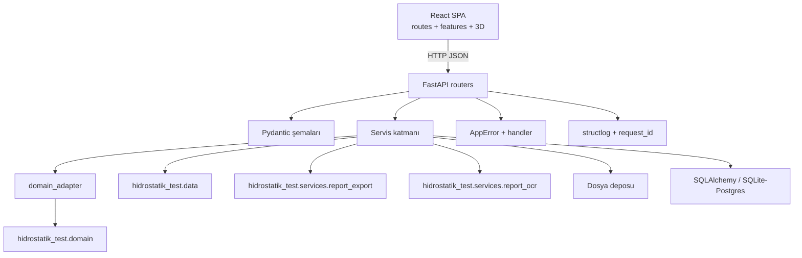
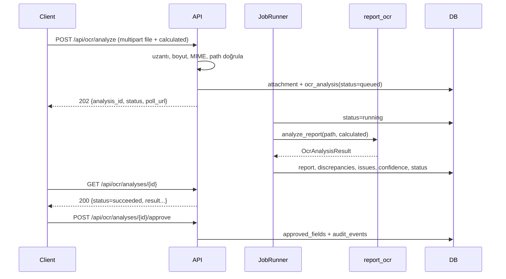

# HYDRO Web — Mimari

**Durum:** Tasarım (uygulama kodu henüz yok)
**Kapsam:** Mevcut Tkinter masaüstü uygulamasının tüm işlevlerinin web'e taşınması
**Hedef sürüm:** Web MVP (auth'suz) → auth'lu sürüm
**İlgili dokümanlar:** [parity_matrix.md](parity_matrix.md), [api_contract.md](api_contract.md), [ux_plan.md](ux_plan.md)

---

## 1. Kapsam ve hedefler

Web uygulaması, `hidrostatik_test/` paketindeki hesaplama motorunu **değiştirmeden**
kullanarak masaüstü uygulamasının tüm kullanıcı girdilerini, hesaplamalarını,
kararlarını, oturum kaydını, rapor üretimini ve OCR ön-kontrolünü sunar.

Ölçülebilir hedefler:

| Hedef | Ölçüt |
|---|---|
| Hesaplama parity | `webapp/docs/parity_matrix.md` içindeki tüm `desktop` satırları için API çıktısı domain çıktısıyla `1e-9` bağıl tolerans içinde eşleşir |
| Girdi parity | Masaüstündeki her alan web formunda karşılık bulur; alan anahtarları parity matrisindeki eşlemeyle birebir aynıdır |
| 3D sahne | Zemin, segmentler, vanalar, pompa, test başlığı, pig, kot profili, basınç/utilization renkleri, döndürme/zoom/kesit |
| Rapor parity | TXT/PDF/XLSX çıktıları masaüstü raporundaki bölüm ve alanları içerir |
| OCR | PDF/görsel yükleme → arka plan analizi → alan onayı + uyuşmazlık paneli; alan eşlemesi konfigüre edilebilir |
| Dağıtım | Tek makinede `python webapp/run_web.py`; LAN'da reverse proxy arkasında; Docker ile buluta taşınabilir |
| Erişilebilirlik | WCAG 2.2 AA, tam klavye kullanımı |

Kapsam dışı (MVP):

- Kullanıcı girişi, rol ve yetki matrisi (sonradan OIDC).
- Bulut OCR / üçüncü taraf API (KVKK gereği reddedildi; bkz. `docs/ocr_report_pipeline.md` §8).
- Elektronik imza / notarization.
- Otomatik güncelleme (web dağıtımında sürüm yönetimi imaja devredilir).
- Masaüstü uygulamasının kaldırılması; iki istemci aynı domain paketini kullanmaya devam eder.

---

## 2. Teknoloji seçimi ve gerekçesi

| Katman | Seçim | Gerekçe | Alternatif ve neden değil |
|---|---|---|---|
| API | **FastAPI** | Pydantic v2 ile sözleşme-önce geliştirme, OpenAPI, `async` dosya/OCR işleri, düşük operasyonel yük | Django: admin/ORM ağır, async dosya işleri daha zahmetli |
| Şema | **Pydantic v2** | `dataclass` tabanlı domain nesneleriyle alan adı eşlemesi kolay; hata mesajları 422'ye standart | marshmallow: iki şema kaynağı |
| ORM | **SQLAlchemy 2.0** | SQLite ve Postgres arasında aynı kod; Alembic ile migration | Ham SQL: iki lehçe bakımı |
| DB | **SQLite (WAL)** → **Postgres** | Yerel/LAN kurulumda sıfır servis; bulutta Postgres'e aynı şema | Sadece SQLite: çok kullanıcıda kilit |
| Migration | **Alembic** | Şema evrimi denetlenebilir | `create_all`: üretimde yetersiz |
| Frontend | **React 19 + TypeScript 5** | Uzun ömürlü, geniş ekosistem, 3D ve grafik kütüphaneleriyle uyum | Vue/Svelte: ekip ve 3D ekosistemi daha dar |
| Build | **Vite 6** | Hızlı HMR, statik build, `run_web.py` ile tek klasörden servis | CRA: bakımda değil |
| Stil | **Tailwind CSS** | Tasarım token'ları (renk/boşluk) tek yerden; yoğun veri ekranında hızlı iterasyon | CSS-in-JS: runtime maliyeti |
| Server state | **TanStack Query v5** | Cache, retry, invalidate, yükleme/hata durumları standart | Redux Toolkit Query: daha fazla kavram |
| Client state | **Zustand** | Form dışı UI durumu (aktif sekme, sahne katmanları, seçili segment) için küçük ve test edilebilir | Context: gereksiz render |
| Form | **react-hook-form + zod** | Alan bazlı doğrulama, `field key` parity, klavye odak yönetimi | Formik: daha yavaş, şema tekrarı |
| 3D | **Three.js + @react-three/fiber + drei** | React yaşam döngüsü içinde sahne; orbit, kesit, raycast seçim hazır | Ham Three.js: durum yönetimi dağınık |
| Grafik | **Recharts** | Basınç/sıcaklık/hacim trendleri, kot profili; küçük bundle | D3: geliştirme maliyeti yüksek |
| Test | **pytest, Vitest, Playwright** | Domain parity, birim, uçtan uca | Sadece E2E: hata ayıklama yavaş |
| Log | **structlog (JSON)** | `request_id` ile uçtan uca iz | print/logging: ayrıştırılamaz |

Sürüm politikası: backend bağımlılıkları `webapp/backend/pyproject.toml` içinde alt/üst sınırla
pinlenir; frontend `package-lock.json` commit edilir. Domain paketinin bağımlılıkları
(`requirements.txt`) web imajında aynen kurulur; **CoolProp sürümü tek kaynaktan** gelir.

---

## 3. Repo yapısı

```text
HYDRO/                                  # mevcut masaüstü repo kökü
├── hidrostatik_test/                   # DEĞİŞMEZ çekirdek (domain/data/services)
├── requirements.txt
├── requirements-ocr.txt
├── docs/                               # masaüstü dokümanları
└── webapp/
    ├── README.md
    ├── run_web.py                      # tek giriş noktası: env, migration, statik, uvicorn
    ├── Dockerfile
    ├── docker-compose.yml
    ├── .dockerignore
    ├── .env.example
    ├── docs/
    │   ├── architecture.md
    │   ├── parity_matrix.md
    │   ├── api_contract.md
    │   └── ux_plan.md
    ├── backend/
    │   ├── pyproject.toml
    │   ├── alembic.ini
    │   ├── alembic/
    │   │   └── versions/
    │   ├── app/
    │   │   ├── main.py                 # FastAPI app, middleware, router mount
    │   │   ├── bootstrap.py            # repo kökünü sys.path'e ekler, ayar okur
    │   │   ├── api/
    │   │   │   ├── deps.py
    │   │   │   └── routers/
    │   │   │       ├── health.py       # /health, /meta, /meta/spec
    │   │   │       ├── catalog.py
    │   │   │       ├── coefficients.py
    │   │   │       ├── calculations.py
    │   │   │       ├── sessions.py
    │   │   │       ├── reports.py
    │   │   │       ├── ocr.py
    │   │   │       └── projects.py
    │   │   ├── core/
    │   │   │   ├── config.py           # pydantic-settings
    │   │   │   ├── errors.py           # AppError, handler'lar
    │   │   │   ├── logging.py
    │   │   │   ├── request_id.py
    │   │   │   ├── security.py         # upload doğrulama, rate limit, CSP
    │   │   │   └── clock.py
    │   │   ├── db/
    │   │   │   ├── base.py
    │   │   │   ├── models.py
    │   │   │   └── session.py
    │   │   ├── schemas/
    │   │   │   ├── common.py
    │   │   │   ├── geometry.py
    │   │   │   ├── coefficients.py
    │   │   │   ├── calculations.py
    │   │   │   ├── sessions.py
    │   │   │   ├── reports.py
    │   │   │   ├── ocr.py
    │   │   │   └── scene.py
    │   │   ├── services/
    │   │   │   ├── catalog_service.py
    │   │   │   ├── coefficient_service.py
    │   │   │   ├── calculation_service.py
    │   │   │   ├── session_service.py
    │   │   │   ├── export_service.py
    │   │   │   ├── ocr_service.py
    │   │   │   ├── ocr_mapping.py
    │   │   │   ├── job_runner.py
    │   │   │   ├── scene_service.py
    │   │   │   └── audit_service.py
    │   │   └── domain_adapter.py       # dataclass <-> Pydantic dönüşümü, tek nokta
    │   └── tests/
    │       ├── parity/
    │       │   ├── generate.py         # domain'den golden JSON üretir
    │       │   └── cases/*.json
    │       ├── test_api_*.py
    │       └── test_services_*.py
    ├── frontend/
    │   ├── package.json
    │   ├── vite.config.ts
    │   ├── tsconfig.json
    │   ├── tailwind.config.ts
    │   ├── index.html
    │   ├── src/
    │   │   ├── main.tsx
    │   │   ├── app/                    # router, layout, providers
    │   │   ├── pages/                  # Dashboard, Projects, Geometry (+Field), Air, Pressure, Reports, OCR, Settings, Coefficients (+Detail)
    │   │   ├── features/               # alan bazlı bileşen + hook + test
    │   │   ├── components/
    │   │   │   ├── ui/                 # Button, Field, Card, Badge, Table, Banner
    │   │   │   ├── charts/             # PressureChart, ElevationProfile, DecisionGauge
    │   │   │   └── three/              # PipelineScene, SceneHtml (DOM etiket katmanı), PipeNetwork, SceneEquipment, PigAndFlow...
    │   │   ├── lib/
    │   │   │   ├── api/                # fetch client, endpoint tipleri
    │   │   │   ├── types.ts            # API sözleşmesinden üretilen/elle tutulan tipler
    │   │   │   ├── format.ts           # tr-TR sayı/tarih/birim biçimleme
    │   │   │   ├── units.ts
    │   │   │   └── validation.ts       # zod şemaları, alan anahtarları
    │   │   └── stores/
    │   ├── e2e/
    │   └── public/
    └── data/                           # git dışı
        ├── hydro_web.db
        ├── uploads/
        └── exports/
```

**Kritik kural:** `hidrostatik_test/` altındaki hiçbir dosya kopyalanmaz. Web katmanı
`from hidrostatik_test.domain import ...`, `from hidrostatik_test.data import ...`,
`from hidrostatik_test.services.report_export import ...`,
`from hidrostatik_test.services.report_ocr import ...` şeklinde import eder.

`run_web.py` ve `app/bootstrap.py`, repo kökünü `sys.path` başına ekler
(`Path(__file__).resolve().parents[1]`); böylece `pip install -e .` olmadan da çalışır.
İleride çekirdek paket `pyproject.toml` ile paketlendiğinde bu enjeksiyon kaldırılır,
yerine sürümlü bağımlılık (`hidrostatik-test==1.7.x`) geçer. Çekirdek sürümü
`/api/meta` içinde raporlanır.

---

## 4. Katmanlar ve bağımlılık yönü



Kurallar:

1. Router iş mantığı içermez: doğrula → servisi çağır → yanıtı dön.
2. Servis katmanı domain'i çağırır; domain'i **asla** yeniden uygulamaz.
3. `domain_adapter.py` tek dönüşüm noktasıdır:
   - `PipeSectionIn` → `PipeSection`
   - `PipeGeometryIn` → `PipeGeometry`
   - `AirContentInputs`, `PressureVariationInputs`, `SectionPressureProfileInputs`,
     `PressurizationInputs` kurulumu
   - domain `ValidationError` → `AppError(code="domain_validation_error", status=400)`
   - `WaterPropertyError` → `AppError(code="water_property_error", status=400)`
   - `ABControlTableError` → `AppError(code="reference_table_error", status=400)`
   - `ReportOcrError` → `AppError(code=<ocr kodu>, status=<eşleme>)`
4. DB modelleri API şeması değildir; JSON kolonları sürümlenir (`schema_version`).

---

## 5. Kimlik, oturum ve yetki

### MVP (auth yok)

- Tarayıcı ilk açılışta `crypto.randomUUID()` ile **çalışma alanı anahtarı** üretir ve
  `localStorage["hydro.workspace_id"]` içinde tutar.
- Her istek `X-Session-ID: <workspace_id>` başlığını taşır. Başlık yoksa middleware
  yeni bir anahtar üretir ve `X-Session-ID` yanıt başlığında döner.
- Bu anahtar **kimlik doğrulama değildir**; yalnızca anonim izolasyon, rate limit ve
  denetim kaydı içindir. Aynı anahtarı bilen herkes aynı veriyi görebilir. Bu nedenle
  MVP yalnızca güvenilir yerel/LAN ağında veya reverse proxy arkasında çalıştırılır.
- `projects` ve `sessions` tablolarında `workspace_id_hash = sha256(X-Session-ID)`
  tutulur; ham değer loglanmaz.
- Domain oturumu (`/api/sessions/{session_id}`) ayrı bir UUID'dir; başlıkla karıştırılmaz.
  Dokümantasyonda başlık "workspace anahtarı" olarak anılır.

### Auth sonrası (planlanan yer)

- `HYDRO_AUTH_MODE=none|oidc`.
- OIDC: Authorization Code + PKCE, sunucu tarafı oturum çerezi veya kısa ömürlü JWT.
- `users`, `memberships (project_id, user_id, role)` tabloları eklenir.
- Roller: `viewer` (okuma), `operator` (girdi/hesap), `approver` (OCR onayı + rapor kilidi),
  `admin` (proje/şablon yönetimi).
- `X-Session-ID` çalışma alanı anahtarı, giriş sonrası `user_id` ile eşlenir; anonim
  veriler tek seferlik "claim" akışıyla devralınabilir.
- OCR onayı ve rapor kilidi `approver` rolüne bağlanır; `audit_events.actor` artık
  kullanıcı kimliğidir.

### Oturum yaşam döngüsü

| Durum | Anlam |
|---|---|
| `draft` | Girdiler düzenleniyor, sonuç yok |
| `active` | En az bir hesaplama var, saha devam ediyor |
| `completed` | Karar verildi, rapor üretildi |
| `archived` | Salt okunur arşiv |
| `deleted` | Soft delete (`deleted_at`), 30 gün sonra fiziksel silme |

Eşzamanlılık: `sessions.revision` her `PUT` ile artar; istemci `If-Match: <revision>`
gönderir. Çakışmada `409 revision_conflict` ve sunucudaki güncel kayıt döner.

---

## 6. Veritabanı şeması

Taşınabilirlik: SQLite'ta `TEXT` UUID, `TEXT` ISO-8601 UTC, `JSON` (TEXT olarak);
Postgres'te `UUID`, `TIMESTAMPTZ`, `JSONB`. SQLAlchemy tipleri (`Uuid`, `JSON`,
`DateTime(timezone=True)`) iki lehçede de çalışır.

### 6.1 `projects`

| Kolon | Tip | Not |
|---|---|---|
| `id` | UUID PK | |
| `workspace_id_hash` | CHAR(64), indexed | Anonim izolasyon |
| `name` | TEXT | |
| `client` | TEXT NULL | |
| `description` | TEXT NULL | |
| `created_at`, `updated_at` | TIMESTAMPTZ | UTC |
| `deleted_at` | TIMESTAMPTZ NULL | soft delete |

İndeks: `(workspace_id_hash, updated_at DESC)`.

### 6.2 `sessions`

| Kolon | Tip | Not |
|---|---|---|
| `id` | UUID PK | |
| `project_id` | UUID NULL FK → projects.id | `ON DELETE SET NULL` |
| `workspace_id_hash` | CHAR(64), indexed | |
| `name` | TEXT | Varsayılan "Oturum N" |
| `status` | TEXT | draft/active/completed/archived |
| `inputs` | JSON | Masaüstü snapshot'ıyla aynı alan adları (segment listesi `segments` olarak normalize edilir), kanonik tipli (number/null/enum); `schema_version: 1` |
| `wizard_state` | JSON NULL | `{active, step, completed[]}` |
| `result_summary` | JSON | Kararlar, uyarı sayıları, son hesaplama zamanı |
| `revision` | INTEGER | Optimistic locking |
| `legacy_id` | TEXT NULL | Masaüstü 12-hex oturum kimliği |
| `notes` | TEXT | |
| `created_at`, `updated_at`, `deleted_at` | TIMESTAMPTZ | |

İndeks: `(workspace_id_hash, updated_at DESC)`, `(project_id)`, `(status)`,
`UNIQUE (legacy_id)` (nullable).

### 6.3 `test_results`

| Kolon | Tip | Not |
|---|---|---|
| `id` | UUID PK | |
| `session_id` | UUID FK → sessions.id | `ON DELETE CASCADE` |
| `test_type` | TEXT | `air`, `pressure`, `coefficient_a`, `coefficient_b`, `profile`, `pig`, `pressurization`, `thermal_balance` |
| `inputs` | JSON | `{payload, session_snapshot}`: hesap payload'ı + o anki oturum girdileri |
| `result` | JSON | Domain sonucu (alan adları domain ile aynı) |
| `decision_status` | TEXT | `BEKLIYOR`, `KATSAYI GUNCELLENMELI`, `DOGRULANAMADI`, `BASARILI`, `BASARISIZ` |
| `decision_title`, `decision_summary`, `decision_rule` | TEXT | |
| `engine_version` | TEXT | `APP_VERSION` + domain şeması |
| `computed_at` | TIMESTAMPTZ | |
| `created_at` | TIMESTAMPTZ | |

İndeks: `(session_id, computed_at DESC)`, `(test_type)`, `(decision_status)`.

### 6.4 `time_series`

| Kolon | Tip | Not |
|---|---|---|
| `id` | UUID PK | |
| `session_id` | UUID FK | CASCADE |
| `timestamp` | TIMESTAMPTZ | Masaüstünde naive yerel; web'de UTC |
| `pressure_bar` | DOUBLE | |
| `temperature_c` | DOUBLE | |
| `volume_m3` | DOUBLE NULL | |
| `notes` | TEXT | |
| `source` | TEXT | manual/import/ocr |
| `created_at` | TIMESTAMPTZ | |

İndeks: `(session_id, timestamp)`, `(timestamp)`.

### 6.5 `attachments`

| Kolon | Tip | Not |
|---|---|---|
| `id` | UUID PK | |
| `session_id` | UUID NULL FK | OCR raporu bir oturuma bağlı olmayabilir |
| `filename` | TEXT | Yalnızca gösterim; disk yolunda kullanılmaz |
| `stored_path` | TEXT | `uploads/<session>/<uuid>.<ext>` (göreli) |
| `mime` | TEXT | Sniff sonucu |
| `size_bytes` | BIGINT | |
| `sha256` | CHAR(64) | Tekrar yükleme tespiti |
| `kind` | TEXT | report_pdf/report_image/other |
| `created_at` | TIMESTAMPTZ | |

İndeks: `(session_id)`, `(sha256)`.

### 6.6 `ocr_analyses`

| Kolon | Tip | Not |
|---|---|---|
| `id` | UUID PK | |
| `session_id` | UUID NULL FK | |
| `attachment_id` | UUID FK | CASCADE |
| `mapping_profile_id` | UUID NULL FK | Aktif alan eşleme profili |
| `status` | TEXT | queued/running/succeeded/failed/cancelled |
| `source` | TEXT | `pdf-text-layer`, `ocr`, `mixed` |
| `page_count` | INT | |
| `confidence` | DOUBLE | 0–1 |
| `report` | JSON | `HydrotestReport.to_dict()` |
| `discrepancies` | JSON | `Discrepancy.to_dict()` listesi |
| `issues` | JSON | `ValidationIssue` listesi |
| `warnings` | JSON | string listesi |
| `needs_human_review` | BOOL | Domain'de her zaman `true` |
| `approved_fields` | JSON NULL | Onaylanan alanlar + onay zamanı |
| `error_code`, `error_message` | TEXT NULL | `ReportOcrError` kodu |
| `created_at`, `started_at`, `finished_at` | TIMESTAMPTZ | |

İndeks: `(status, created_at)`, `(session_id)`, `(attachment_id)`.

### 6.7 `ocr_mapping_profiles`

Rapor formatı yarın verileceği için alan eşlemesi **veri**dir, kod değildir.

| Kolon | Tip | Not |
|---|---|---|
| `id` | UUID PK | |
| `name` | TEXT | Örn. "BOT-FRM-CDB-001-021 R2" |
| `format_key` | TEXT UNIQUE | Örn. `bot-frm-cdb-001-021` |
| `schema_version` | INT | |
| `mode` | TEXT | `pre_extract` (varsayılan) \| `post_map` |
| `mapping` | JSON | Etiket alias → kanonik alan, birim/required varsayılanı, bölüm ipuçları |
| `is_default` | BOOL | Tek default |
| `created_at`, `updated_at` | TIMESTAMPTZ | |

`mapping` örneği:

```json
{
  "schema_version": 1,
  "sections": [
    {"name": "air", "heading_aliases": ["Hava İçerik Testi", "Air Content Test"], "before": "pressure"}
  ],
  "fields": {
    "test_pressure_bar": {
      "aliases": ["Test Basıncı", "Hidrostatik Test Basıncı", "Ptest"],
      "unit": "bar",
      "required": true
    },
    "air_test.vpa": {
      "aliases": ["Fiili İlave Su", "Gerçek Hacim", "Vpa"],
      "canonical_field": "air_test.vpa",
      "unit": "m3",
      "required": false
    }
  },
  "table_hints": {"column_count": 2, "label_value_layout": "same_line"}
}
```

Varsayılan profil, mevcut `report_ocr.FIELD_ALIASES` sözlüğünden üretilir; yeni format
gelince **yalnızca yeni profil** eklenir. Profil yoksa servis mevcut gömülü sözlükle çalışır
(geri uyum).

### 6.8 `audit_events`

| Kolon | Tip | Not |
|---|---|---|
| `id` | UUID PK | |
| `session_id` | UUID NULL | |
| `actor` | TEXT | MVP: `anonymous:<hash8>`; auth sonrası `user:<id>` |
| `action` | TEXT | `session.create`, `session.update`, `result.create`, `report.export`, `ocr.approve`, `ocr.mapping.update`, `attachment.delete` |
| `entity_type`, `entity_id` | TEXT | |
| `before`, `after` | JSON NULL | Alan bazlı diff |
| `request_id` | TEXT | |
| `created_at` | TIMESTAMPTZ | |

İndeks: `(session_id, created_at DESC)`, `(action)`.

### 6.9 Saklama ve temizlik

- `deleted_at` dolu oturumlar 30 gün sonra fiziksel silinir (cascade + dosya).
- OCR ham metni (`report.raw_text`) 90 gün sonra `NULL`'lanır; sayısal onaylar kalır.
- `audit_events` 2 yıl saklanır.
- Süreler `HYDRO_RETENTION_*` env değişkenleriyle değiştirilebilir.

---

## 7. Dosya depolama

Kök: `HYDRO_DATA_DIR` (varsayılan `webapp/data`).

```text
data/
├── hydro_web.db
├── uploads/
│   └── <session_uuid | _unassigned>/<attachment_uuid>.<ext>
└── exports/
    └── <session_uuid>/<timestamp>-<kind>.<ext>
```

Kurallar:

1. Kullanıcı dosya adı **yola yazılmaz**; yalnızca `attachments.filename` olarak saklanır.
2. Uzantı, `report_ocr.SUPPORTED_EXTENSIONS` kümesinden olmalıdır
   (`.pdf`, `.png`, `.jpg`, `.jpeg`, `.tif`, `.tiff`, `.bmp`, `.webp`).
3. Boyut sınırı `MAX_FILE_SIZE_BYTES` (25 MB) ile aynıdır; proxy `client_max_body_size`
   en az 30 MB olmalıdır.
4. MIME sniffing: ilk 4 KB üzerinden sihirli bayt kontrolü + `Pillow.verify()` (görsel)
   veya `pypdf` başlık kontrolü (PDF). Uzantı/MIME uyuşmazlığı `415 unsupported_media_type`.
5. Yazma atomiktir: `uploads/.tmp/<uuid>` → `os.replace()`.
6. Erişim yalnızca `attachment_id` üzerinden; indirme route'u `stored_path`'i
   `data/uploads` köküne göre `resolve()` edip `is_relative_to(root)` doğrular.
7. `..`, mutlak yol, sembolik bağlantı reddedilir; dosya izinleri `0600`, dizin `0700`.
8. Zip/bellek içi arşiv kabul edilmez; makro/script içeren doküman kapsam dışıdır.
9. Yükleme sonrası SHA-256 hesaplanır; aynı oturumda aynı dosya tekrar yüklenirse
   mevcut analiz döner (`200` + `reused: true`).

Temizlik: başarısız/iptal analizlerin dosyaları 24 saat sonra silinir; `_unassigned`
klasörü 7 gün sonra boşaltılır.

---

## 8. Hata modeli

Tüm hatalar tek zarf kullanır:

```json
{
  "code": "domain_validation_error",
  "message": "Et kalinligi borunun ic capini sifira dusurecek kadar buyuk olamaz.",
  "details": {
    "field": "geometry.wall_thickness_mm",
    "rule": "2*wt < od"
  },
  "request_id": "6f1c0b1e-5d7a-4d0e-9f6b-2f4f0a8f3c11"
}
```

| HTTP | `code` | Kaynak |
|---|---|---|
| 400 | `domain_validation_error` | `hidrostatik_test.domain.ValidationError` |
| 400 | `water_property_error` | `WaterPropertyError` (aralık dışı T/P, backend yok) |
| 400 | `reference_table_error` | `ABControlTableError` (tablo aralığı dışı) |
| 400 | `invalid_calculated` | OCR karşılaştırma payload'ı bozuk |
| 401/403 | `unauthorized` / `forbidden` | Auth sonrası |
| 404 | `not_found` | Kaynak yok |
| 404 | `file_not_found` | OCR dosya yok |
| 400 | `invalid_path` | OCR yol geçersiz/izin verilmiyor |
| 409 | `revision_conflict` | Eşzamanlı oturum güncellemesi |
| 409 | `ocr_already_running` | Aynı dosya için aktif iş |
| 413 | `file_too_large` | 25 MB üstü |
| 415 | `unsupported_format` | Uzantı/MIME |
| 422 | `validation_error` | Pydantic; `details.errors[]` |
| 422 | `empty_file` / `empty_text` / `corrupt_document` / `corrupt_image` / `encrypted_pdf` | OCR |
| 429 | `rate_limited` | Başlıkta `Retry-After` |
| 500 | `internal_error` | Beklenmeyen; log'da stack, yanıtta gizli |
| 503 | `ocr_unavailable` / `dependency_missing` | Tesseract/Pillow yok |
| 504 | `ocr_timeout` | OCR işi 300 s'yi aştı |

Pydantic hata gövdesi:

```json
{
  "code": "validation_error",
  "message": "Girdi dogrulanamadi.",
  "details": {
    "errors": [
      {"loc": ["body", "geometry", "sections", 0, "wall_thickness_mm"],
       "msg": "Input should be greater than 0", "type": "greater_than"}
    ]
  },
  "request_id": "..."
}
```

`request_id` her yanıtta ve `X-Request-ID` başlığında bulunur; istemci gönderdiyse korunur.

---

## 9. Hesaplama servisleri (domain eşlemesi)

| Servis fonksiyonu | Domain çağrısı | Not |
|---|---|---|
| `geometry_from_payload` | `PipeSection`, `PipeGeometry` | En az bir segment; `2*wt < od` |
| `coefficient_a` | `calculate_water_compressibility_a(temp_c, pressure_bar, backend)` | `backend=None` → `get_default_water_property_backend()` |
| `coefficient_b` | `resolve_b_value(source, temp_c, pressure_bar, steel_alpha_micro_per_c, steel_model)` | `BSource` enum |
| `coefficient_compare` | `compare_b_sources(...)` | institutional/gail/auto + delta'lar |
| `reference_point` | `lookup_botas_reference_point`, `lookup_gail_reference_point` | A/B tablo değerleri, `repaired` bilgisi |
| `air_content` | `AirContentInputs` + `evaluate_air_content_test` | `P` tam `1.0` bar değilse domain reddeder |
| `pressure_variation` | `PressureVariationInputs` + `evaluate_pressure_variation_test` | `Pa` işareti: `Pilk - Pson` |
| `pressure_profile` | `SectionPressureProfileInputs` + `evaluate_section_pressure_profile` | `location_class` `get_location_class_rule(label)` ile |
| `pig_speed` | `get_pig_speed_limit(option)` + `evaluate_pig_speed(distance, time, limit)` | Limit `None` → `passed=None` |
| `pressurization` | `PressurizationInputs` + `evaluate_pressurization` | %0.2 tek taraflı |
| `thermal_balance` | `TimeSeriesStore.from_dict` + `check_thermal_balance()` | ≥24 saat, son 4 saat vs önceki 4 saat |
| `water_density` | `calculate_water_density(temp_c, pressure_bar)` | Hidrolik kot farkı hesabında 15 °C kullanılır (domain sabiti) |
| `backend_comparison` | `get_available_water_property_backends`, `get_water_property_backend` | A/B/yoğunluk karşılaştırması |

**Yeniden uygulama yasağı:** `0.884`, `1.06`, `0.3`, `1.25`, `1.50`, `20*SMYS*t/OD`,
`20000 m`, `12500 m³`, `0.2 %`, `24 h`, `0.5 °C` gibi tüm sabitler domain'den
**import edilir** (`AIR_CONTENT_ACCEPTANCE_FACTOR`, `PRESSURE_VARIATION_ACCEPTANCE_BAR`,
`CLASS_1_2_MIN_FACTOR`, `MAX_TEST_SECTION_LENGTH_M`, …). Frontend yalnızca gösterim
metni taşır; hesap yapmaz.

Karar üretimi de sunucudadır. `decision_status` domain sonucundan türetilir:

- `air`: `passed ? "BASARILI" : "BASARISIZ"`
- `pressure`: aynı
- katsayı hazır değilse: `DOGRULANAMADI`; girdi değişip katsayı bayatladıysa:
  `KATSAYI GUNCELLENMELI`
- pig: `UYGUN` / `LIMIT ASILDI` / `BILGI`
- profil: `feasible` + monitored kontrolleri

---

## 10. Rapor dışa aktarma

Üç format, tek içerik sözleşmesi:

| Format | Üretici | İçerik |
|---|---|---|
| PDF | `hidrostatik_test.services.report_export.export_pdf_report(path, title, metadata, geometry_data, test_results, checklist_data)` | A4, DejaVu Unicode font (varsa), metadata + geometri + sonuç + checklist tabloları |
| XLSX | `export_excel_report(...)` aynı imza | Tek sayfa, bölüm başlıkları, formül nötralizasyonu |
| TXT | `services/export_service.build_report_text()` | Masaüstü `_build_report_text()` bölümleriyle birebir: Boru Kesiti, Segment Listesi, Hava Girdileri, Basınç Girdileri, Operasyon Kontrol Noktaları, Pig, Nihai Karar, Oturum Sonuçları, Not |

TXT üreticisi UI'dan bağımsız yeni bir servis fonksiyonudur; masaüstü metodu kopyalanmaz,
ancak **alan listesi parity matrisindeki rapor bölümüyle** doğrulanır.

Ek kurallar:

- Çıktı `data/exports/<session>/` altına atomik yazılır, sonra `FileResponse` ile sunulur.
- `metadata` en az: sürüm, şartname kodu/başlığı, oluşturma zamanı, su backend'i,
  B kaynağı, oturum adı, seçili pompa konumu.
- PDF fontu konteynerde `fonts-dejavu-core` ile garanti edilir; yoksa Helvetica'ya düşer
  (Türkçe karakter kaybı riski — build testi bunu kontrol eder).
- Excel formül enjeksiyonu `report_export` içinde zaten nötralize edilir; web katmanı
  ham kullanıcı metnini doğrudan hücreye yazmaz.
- Rapor kilidi (auth sonrası): `completed` oturumda export, `approver` onayı ister.

---

## 11. OCR akışı

Mevcut servis korunur; web yalnızca dosya, kuyruk ve onay katmanını ekler.



Kararlar:

- **Kuyruk:** MVP'de DB tabanlı kuyruk + tek worker thread (Tesseract CPU'yu tek başına
  doyurur). Job tablosu `ocr_analyses.status`; `SELECT ... WHERE status='queued'
  ORDER BY created_at LIMIT 1` + `UPDATE ... WHERE status='queued'` atomik claim.
  Çok instance'a geçişte Redis/RQ veya Postgres `FOR UPDATE SKIP LOCKED`.
- **Zaman aşımı:** 300 s; aşılırsa `status=failed`, `error_code=ocr_timeout` (yeni kod,
  servis dışında üretilir) ve kullanıcıya yeniden deneme önerilir.
- **İptal:** `POST /api/ocr/analyses/{id}/cancel`; worker sonuç yazmadan önce
  `status='running'` kontrolü yapar. Çalışan Tesseract süreci zorla sonlandırılmaz;
  iptal, sonucun yazılmaması anlamına gelir (CPU işi arka planda biter).
- **Eşzamanlılık:** Aynı `attachment_id` için `queued|running` varsa `409 ocr_already_running`.
- **Alan eşleme:** `mapping_profile_id` verilmezse `is_default` profil; o da yoksa gömülü
  `FIELD_ALIASES` ile `analyze_report` **değişmeden** çağrılır. Profil varsa iki mod:
  1. `profile.mode = "pre_extract"` (varsayılan): web katmanı `extract_text` ile sayfaları
     alır, profil alias'larını `PageText.text` üzerinde kanonik etiketlere **yeniden
     yazar**, sonra servisin `parse_report`, `validate_report` ve
     `compare_with_calculated` fonksiyonlarını çağırır. Böylece yeni form etiketleri
     servis değiştirilmeden tanınır; yalnızca orkestrasyon (~20 satır) web katmanındadır.
  2. `profile.mode = "post_map"`: `parse_report` sonrası kanonik alan → kanonik alan
     yeniden yönlendirmesi (ör. formdaki "A"nın basınç testine atanması) ve birim/required
     varsayılanları. Servis hiç değişmez.
  Profil şeması MVP'de `aliases`, `canonical_field`, `unit`, `required`, `section`
  taşır; serbest `regex` S5b'ye bırakılmıştır (servisin sayı/tarih ayrıştırıcısı zaten
  kullanılır).
- **Taranmış PDF sınırı:** metin katmanı olmayan PDF'in rasterleştirilmesi için
  `PyMuPDF` (AGPL) veya `pdf2image` + Poppler gerekir; `requirements-ocr.txt` bunları
  varsayılan olarak kurmaz. İmaj, varsayılan haliyle **metin katmanlı PDF + görsel**
  OCR yapar. Taranmış PDF desteği, kurumsal lisans onayıyla `poppler-utils` +
  `pdf2image` eklenerek açılır; aksi halde `ocr_unavailable` döner.
- **Onay:** `needs_human_review` her zaman `true`. Onay endpoint'i her alan için
  `{value, unit, approved: true}` alır; düşük güvenli (<0.6) alanlar onaylanmadan
  `approve_all` reddedilir (`422 low_confidence_unreviewed`). Onaylanan değerler
  `approved_fields` ve `audit_events`'e yazılır; ham `report` **değiştirilmez**.
- **Oturuma uygulama:** `POST /api/ocr/analyses/{id}/apply` seçili alanları oturum
  girdilerine yazar (opsiyonel; onaydan ayrı). Çakışan alanlar `details.conflicts` ile
  döner.

---

## 12. 3D sahne veri modeli

Sahne, oturum girdilerinden **sunucuda** üretilir (`scene_service.build_scene(session)`),
böylece masaüstü ve web aynı kot/istasyon türetimini kullanır. Frontend yalnızca çizer.

```ts
type Vec3 = [number, number, number];

interface SceneModel {
  schema_version: 1;
  units: { length: "m"; elevation: "m"; pressure: "bar"; diameter: "mm" };
  extent: {
    station_start_m: number;
    station_end_m: number;
    elevation_min_m: number;
    elevation_max_m: number;
    bounding_radius_m: number;
  };
  profile: Array<{ station_m: number; elevation_m: number }>;
  segments: SceneSegment[];
  equipment: {
    valves: SceneValve[];
    pump: ScenePump;
    test_head: SceneTestHead;
    pig: ScenePig;
  };
  ranges: {
    pressure_bar: { min: number; max: number };
    utilization: { min: number; max: number }; // 0..1, 100% SMYS'e oran
  };
  layers: SceneLayer[];
  warnings: string[];
}

interface SceneSegment {
  id: string;                 // "seg-1"
  index: number;              // 1 tabanlı, masaüstü tablosuyla aynı
  nps_label: string | null;
  schedule_label: string | null;
  station_start_m: number;
  station_end_m: number;
  length_m: number;
  elevation_start_m: number;
  elevation_end_m: number;
  od_mm: number;
  wt_mm: number;
  id_mm: number;              // od - 2*wt
  grade: string | null;
  smys_mpa: number | null;
  pressure_at_100_smys_bar: number | null; // 20*SMYS*wt/od
  pressure_bar: number | null;             // izlenen basınçtan hidrostatik türetim
  utilization: number | null;              // pressure / 100%SMYS limiti
  status: "ok" | "warning" | "critical" | "unknown";
}

interface SceneValve {
  id: string;
  station_m: number;
  elevation_m: number;
  kind: "mainline" | "vent" | "drain" | "test_head";
  label: string;
  state: "open" | "closed" | "unknown";
}

interface ScenePump {
  station_m: number;
  elevation_m: number;
  side: "start" | "end";
  monitored_pressure_bar: number | null;
}

interface SceneTestHead {
  station_m: number;
  elevation_m: number;
  label: string;
  pressure_bar: number | null;
}

interface ScenePig {
  station_m: number;
  speed_m_per_s: number | null;
  travel_time_min: number | null;
  label: string;
  limit_status: "ok" | "exceeded" | "info" | "unknown";
}

type SceneLayer =
  | "ground" | "pipe" | "valves" | "pump" | "test_head" | "pig"
  | "flow" | "elevation_profile" | "pressure_colors" | "labels";
```

Türetim kuralları:

1. **İstasyon:** Segmentler sırayla zincirlenir; `station_start = önceki station_end`,
   ilk segment `0`. Segment uzunlukları `PipeSection.length_m`.
2. **Kot:** `profile` noktaları `station → elevation` eşlemesi verir. Masaüstünde yalnızca
   `start/end/highest/lowest` vardır; MVP'de bu dört nokta ile **parçalı doğrusal** bir
   profil üretilir (start → highest/lowest → end; yüksek/düşük noktanın istasyonu
   bilinmediği için `start + (end-start)/2` varsayılır ve `warnings`'e "profil yaklaşık"
   notu eklenir). Gerçek saha profili için parity+ uzantısı: `profile_points[]`
   (`station_m`, `elevation_m`) — bkz. parity_matrix "eksik/karar gereken".
3. **Basınç:** Seçili pompa noktasından itibaren hidrostatik hat:
   `p(s) = p_pump - ρ·g·(h(s) - h_pump)/1e5`, `ρ = calculate_water_density(15 °C, 1 bar)`.
   `p_pump`, o test için girilen `pressure_bar` / `air.pressure_bar` değeridir.
   `p(s) < 0` ise 0'a kırpılır ve `warnings`'e negatif basınç notu eklenir. Segmentsel
   `pressure_bar` alanı **segment başlangıç istasyonundaki** değeri taşır; sahne
   yüzeyinde istasyon boyunca enterpolasyon yapılır.
4. **Utilization:** `p(s) / (20·SMYS·wt/od)`. SMYS yoksa `null`; renk `unknown`.
5. **Ekipman:** Masaüstünde vana/pompa/test başlığı konumu yoktur. MVP'de:
   - pompa: seçili uçta (`START_PUMP_LOCATION` / `END_PUMP_LOCATION`)
   - test başlığı: pompa ile aynı istasyon, +1 m offset
   - vanalar: başlangıç, bitiş ve her segment sınırında `mainline` (sembolik)
   Gerçek konumlar için parity+ uzantısı: `equipment_input[]` (station, kind, label, state).
6. **Pig:** `station = pig_distance_m % total_length`; animasyon hızı
   `speed_m_per_s` (m/s → sahne birimi/s). Limit durumu `evaluate_pig_speed` sonucundan.
7. **Kesit:** Kamera düzlemi ile `clipPlane` kesiti; kesilen segment iç yüzeyi `id_mm`
   ile çizilir, et kalınlığı halkası görünür.
8. **Ölçek:** Od (mm) → görsel yarıçap: `r_visual = clamp(od_mm / 1000 / 2, 0.05, 2.0)`;
   dikey abartı `HYDRO_SCENE_VERTICAL_EXAGGERATION` (varsayılan 3.0) ile.
9. Sahne **hesap yapmaz**; tüm sayılar sunucudan gelir. `warnings` boş değilse UI'da
   "yaklaşık sahne" rozeti görünür.

---

## 13. Dağıtım

### 13.1 Yerel / LAN

```bash
python3 -m pip install -r requirements.txt -r requirements-ocr.txt
python3 webapp/run_web.py --host 0.0.0.0 --port 8080
```

`run_web.py` sırası:

1. `webapp/backend` ve repo kökünü `sys.path`'e ekler.
2. `Settings` (pydantic-settings) okur, `HYDRO_DATA_DIR` altını oluşturur.
3. Alembic `upgrade head` çalıştırır (SQLite kilidi için tek process).
4. DB yoksa ilk projeyi/oturumu oluşturmaz; boş durum UI'da karşılanır.
5. `frontend/dist` varsa `/` altına mount eder; yoksa API-only modda çalışır ve
   `/` üzerinde "frontend build yok" JSON'u döner.
6. `uvicorn.run(app, workers=1)` (SQLite için tek worker; Postgres'te `HYDRO_WEB_WORKERS`).

LAN notu: MVP'de auth yok; yalnızca güvenilir ağda çalıştırın veya reverse proxy'de
IP allowlist + basic auth kullanın. Varsayılan `--host 127.0.0.1`'dir; `0.0.0.0`
bilinçli bir tercihtir ve log'da uyarı üretir.

### 13.2 Docker

```dockerfile
# 1) frontend build
FROM node:22-alpine AS fe
WORKDIR /app
COPY webapp/frontend/package*.json ./
RUN npm ci
COPY webapp/frontend/ ./
RUN npm run build

# 2) runtime
FROM python:3.12-slim
ENV PYTHONDONTWRITEBYTECODE=1 PYTHONUNBUFFERED=1
RUN apt-get update && apt-get install -y --no-install-recommends \
    tesseract-ocr tesseract-ocr-tur tesseract-ocr-eng \
    fonts-dejavu-core libgl1 libglib2.0-0 && rm -rf /var/lib/apt/lists/*
WORKDIR /app
COPY requirements.txt requirements-ocr.txt ./
RUN pip install --no-cache-dir -r requirements.txt -r requirements-ocr.txt
COPY hidrostatik_test/ ./hidrostatik_test/
COPY webapp/ ./webapp/
COPY --from=fe /app/dist ./webapp/frontend/dist
RUN useradd -m hydro && mkdir -p /data && chown -R hydro /data
USER hydro
ENV HYDRO_DATA_DIR=/data HYDRO_WEB_HOST=0.0.0.0 HYDRO_WEB_PORT=8080
EXPOSE 8080
HEALTHCHECK CMD python -c "import urllib.request;urllib.request.urlopen('http://127.0.0.1:8080/api/health')"
CMD ["python", "webapp/run_web.py"]
```

`.dockerignore` en az `webapp/data/`, `webapp/frontend/node_modules/`, `webapp/frontend/dist/`,
`**/__pycache__/`, `.git/`, `dist/`, `release/` içerir; aksi halde build bağlamı büyür ve
yerel veri imaja sızar.

`docker-compose.yml` (özet):

```yaml
services:
  web:
    build: { context: .., dockerfile: webapp/Dockerfile }
    ports: ["8080:8080"]
    environment:
      HYDRO_DB_URL: postgresql+psycopg://hydro:hydro@db:5432/hydro
      HYDRO_DATA_DIR: /data
      HYDRO_CORS_ORIGINS: ""
      HYDRO_OCR_ENABLED: "true"
    volumes: ["hydro_data:/data"]
    depends_on: { db: { condition: service_healthy } }
  db:
    image: postgres:16
    environment: { POSTGRES_DB: hydro, POSTGRES_USER: hydro, POSTGRES_PASSWORD: hydro }
    volumes: ["pg_data:/var/lib/postgresql/data"]
    healthcheck:
      test: ["CMD-SHELL", "pg_isready -U hydro"]
      interval: 5s
volumes: { hydro_data: {}, pg_data: {} }
```

### 13.3 Ortam değişkenleri

| Değişken | Varsayılan | Açıklama |
|---|---|---|
| `HYDRO_WEB_HOST` | `127.0.0.1` | Bind adresi |
| `HYDRO_WEB_PORT` | `8080` | Port |
| `HYDRO_WEB_WORKERS` | `1` | SQLite'ta 1; Postgres'te artırılabilir |
| `HYDRO_DB_URL` | `sqlite:///webapp/data/hydro_web.db` | SQLAlchemy URL |
| `HYDRO_DATA_DIR` | `webapp/data` | Upload/export kökü |
| `HYDRO_CORS_ORIGINS` | boş | Virgüllü origin listesi; boşsa same-origin |
| `HYDRO_TRUSTED_HOSTS` | `localhost,127.0.0.1` | Host header doğrulama |
| `HYDRO_MAX_UPLOAD_MB` | `25` | OCR dosya sınırı |
| `HYDRO_OCR_ENABLED` | `true` | Kuyruk/worker açık/kapalı |
| `HYDRO_OCR_LANG` | `tur+eng` | Tesseract dil |
| `HYDRO_TESSERACT_CMD` | boş | Binary yolu |
| `HYDRO_OCR_TIMEOUT_S` | `300` | İş zaman aşımı |
| `HYDRO_FRONTEND_DIST` | `webapp/frontend/dist` | Statik kök |
| `HYDRO_AUTH_MODE` | `none` | `none` / `oidc` |
| `HYDRO_OIDC_ISSUER`, `_CLIENT_ID`, `_CLIENT_SECRET` | boş | Auth sonrası |
| `HYDRO_SESSION_TTL_DAYS` | `30` | Soft delete sonrası fiziksel silme |
| `HYDRO_LOG_LEVEL` | `INFO` | |
| `HYDRO_LOG_FORMAT` | `json` | `json` / `console` |
| `HYDRO_PDF_FONT_DIR` | boş | `report_export` font dizini |
| `HYDRO_SCENE_VERTICAL_EXAGGERATION` | `3.0` | 3D dikey abartı |
| `HYDRO_RATE_LIMIT_UPLOAD` | `10/hour` | Workspace başına |
| `HYDRO_RATE_LIMIT_CALC` | `240/minute` | |
| `HYDRO_RATE_LIMIT_OCR` | `30/hour` | Workspace başına analiz |

### 13.4 Reverse proxy

Nginx örneği:

```nginx
server {
  listen 443 ssl http2;
  server_name hydro.example.internal;
  client_max_body_size 30m;
  proxy_read_timeout 330s;

  location /api/ {
    proxy_pass http://127.0.0.1:8080;
    proxy_set_header Host $host;
    proxy_set_header X-Forwarded-For $proxy_add_x_forwarded_for;
    proxy_set_header X-Forwarded-Proto $scheme;
    proxy_set_header X-Request-ID $request_id;
  }
  location / {
    proxy_pass http://127.0.0.1:8080;
  }
}
```

Notlar:

- TLS proxy'de sonlanır; uygulama `X-Forwarded-Proto` okur ve secure cookie/redirect üretir.
- `client_max_body_size` uygulama sınırından büyük olmalı; aksi halde 413 HTML olarak döner.
- OCR uzun sürdüğü için `proxy_read_timeout` ≥ 330 s veya iş polling modeli (önerilen).
- CORS yalnızca ayrı origin'de frontend geliştirilirken açılır; üretimde same-origin.

### 13.5 Yedekleme

- **SQLite:** günlük `VACUUM INTO '/backup/hydro-YYYYMMDD.db'` (online, kilit almaz) +
  `wal`/`shm` kopyası. 30 gün rotasyon.
- **Postgres:** `pg_dump -Fc` günlük, WAL arşivi opsiyonel.
- **Dosyalar:** `data/uploads` ve `data/exports` rsync/tar; DB ile aynı snapshot'ta.
- **Geri yükleme tatbikatı:** çeyrekte bir, boş bir ortamda `restore → /api/health → örnek
  oturum export` adımları çalıştırılır. RTO hedefi 1 saat, RPO 24 saat (yerel kurulum).

---

## 14. Test stratejisi

| Seviye | Araç | Kapsam | Kapı |
|---|---|---|---|
| Domain parity | pytest | `webapp/backend/tests/parity/cases/*.json` → API yanıtı vs domain altın değeri, `rel=1e-9` | Her PR |
| Servis | pytest | Dosya depolama, path traversal, MIME, migration, kuyruk, audit | Her PR |
| API sözleşmesi | pytest + OpenAPI snapshot | Şema alan adları, hata kodları, 422/400/404 | Her PR |
| Frontend birim | Vitest | `format.ts`, `units.ts`, zod şemaları, store'lar, sahne türetimi | Her PR |
| Bileşen | Vitest + Testing Library | Form kapıları, karar kartı, uyuşmazlık tablosu | Her PR |
| E2E | Playwright | Geometri → A/B → hava + basınç → rapor → oturum; OCR mock | Merge öncesi |
| Görsel regresyon | Playwright screenshot | Dashboard, 3D sahne (sabit kamera), rapor önizleme | Haftalık |
| Yük | k6 (opsiyonel) | 50 eşzamanlı oturum, 10 OCR/saat | Sürüm öncesi |

Parity fixture üretimi:

```text
python -m webapp.backend.tests.parity.generate
```

Komut, domain fonksiyonlarını çağırır ve şu dosyaları yazar:

- `cases/air_basic.json` — 16" OD 8.74 mm, 1000 m, A=44.972, P=1.0, K=1.02, Vpa=0.00775
- `cases/air_boundary_106.json` — tam `1.06·Vp` sınırı (FAIL beklenir)
- `cases/pressure_negative_b.json` — 3 °C, negatif B
- `cases/profile_limits.json` — `>20000 m` ve `>12500 m³` ayrı ayrı
- `cases/gail_border.json` — 26 °C'de institutional hata, GAIL başarı
- `cases/anomaly_7c_90bar.json` — onarılmış A ve `repaired=true`
- `cases/pig_four_modes.json`
- `cases/pressurization_underfill.json`
- `cases/thermal_insufficient.json`

Fixture'lar **elle yazılmaz**; domain'den üretilir. Böylece web katmanı domain'i
kopyalamadığını kanıtlar. Domain değişirse fixture'lar yenilenir ve fark bilinçli onaylanır.

---

## 15. Gözlemlenebilirlik

- **Log:** JSON satırları; alanlar `ts, level, request_id, route, method, status,
  duration_ms, workspace_hash8, session_id, event`. `session_id` UUID'dir, kişisel veri
  değildir; dosya adı/operatör adı loglanmaz.
- **Request ID:** middleware üretir/okur; yanıt başlığında döner; hata zarfında bulunur.
- **`GET /api/health`:**

```json
{
  "status": "ok",
  "version": "1.7.3",
  "engine": "hidrostatik_test",
  "db": {"ok": true, "dialect": "sqlite", "migration": "0001"},
  "data_dir": {"ok": true, "writable": true},
  "ocr": {"available": true, "status": "OCR hazir (Tesseract + Pillow).", "queue": {"queued": 0, "running": 0}},
  "uptime_s": 3821
}
```

`status`: `ok` | `degraded` (OCR yok ama API çalışıyor) | `fail` (DB yok).
HTTP her durumda 200; orchestrator `status` alanına bakar; `/api/health?strict=1` ise
`degraded/fail` → 503.

- **`GET /api/meta`:** sürümler, şartname, desteklenen backend'ler, B kaynakları, steel
  modelleri, location class'lar, pig modları, limitler, karar durumları, para birimi
  olmayan birim kataloğu. Frontend sabit metinleri buradan okur.
- **Metrikler (opsiyonel):** `/metrics` Prometheus; istek sayısı/süresi, OCR kuyruk
  derinliği, hesaplama süresi histogramı. MVP'de kapalı, `HYDRO_METRICS=1` ile açılır.
- **Denetim:** `audit_events` tablosu; kritik aksiyonlar (export, OCR onayı, silme,
  migration) her zaman yazılır.

---

## 16. Güvenlik

| Konu | Önlem |
|---|---|
| Dosya yükleme | Uzantı allowlist, MIME sniff, 25 MB, atomik yazma, `0600` |
| Path traversal | Kullanıcı adı yola girmez; `resolve().is_relative_to(root)`; symlink reddi |
| OCR motoru | Sabit binary yolu (`HYDRO_TESSERACT_CMD`), shell yok, argüman listesi; dil paketi yerel |
| Rate limit | Upload 10/saat/workspace, hesaplama 240/dk, OCR analiz 30/saat; proxy'de ek katman |
| CORS | Varsayılan kapalı (same-origin); allowlist env ile |
| CSP | `default-src 'self'; img-src 'self' blob: data:; style-src 'self' 'unsafe-inline'; script-src 'self'; connect-src 'self'; object-src 'none'; base-uri 'none'; frame-ancestors 'none'` |
| XSS | React varsayılan escape; `dangerouslySetInnerHTML` yasak; rapor metni `<pre>` |
| SQL injection | ORM parametreli; ham SQL yok |
| Excel/PDF injection | `report_export` nötralizasyonu; web ek katman eklemez, test eder |
| Secrets | Yalnızca env/secret store; repoda yok; log'da maskeli |
| TLS | Reverse proxy; HSTS; secure cookie (auth sonrası) |
| Yetki | MVP'de yok → güvenilir ağ varsayımı; auth sonrası rol kontrolü route deps'te |
| Denetim | `audit_events` + `request_id`; silme soft delete |
| KVKK | Yerel işleme; bulut OCR yok; log'da PII yok; saklama süreleri env ile |
| Bağımlılık | `pip-audit` / `npm audit` CI'da; imaj digest ile pin |

Ek not: `iapws95_dev` backend'i GPLv3 bağımlılığı nedeniyle yalnızca geliştirme modunda
listelenir (`dev_mode`); üretimde `get_available_water_property_backends()` varsayılanı
kullanılır.

---

## 17. Aşamalı teslim planı (vertical slices)

Her dilim kendi başına deploy edilebilir ve ölçülebilir kabul kriteri taşır.

| Dilim | İçerik | Kabul kriteri |
|---|---|---|
| **S0 — İskelet** | `run_web.py`, FastAPI app, settings, hata zarfı, request id, `/api/health`, `/api/meta`, DB migration 0001, frontend shell + layout | `pytest` yeşil; `GET /api/health` 200; `npm run build` başarılı; boş dashboard açılıyor |
| **S1 — Katalog + katsayılar** | `/catalog/*`, `/coefficients/a`, `/coefficients/b`, `/coefficients/compare`, referans tablo okuma; Katsayılar sekmesi | Parity: 6 (T,P) noktasında A/B institutional/GAIL/auto değerleri `1e-9`; tablo aralığı dışı 400 |
| **S2 — Hava + basınç** | `/calculations/air-content`, `/pressure-variation`; Hava/Basınç sekmeleri, karar kartı, canlı doğrulama | Parity: hava ve basınç fixture'ları birebir; tam `1.06·Vp` FAIL; negatif B senaryosu geçer; zorunlu alan kapıları çalışır |
| **S3 — Geometri + profil + 3D** | `/calculations/pressure-profile`, `/catalog/pipes`, segment CRUD, kot şeması, `/sessions/{id}/scene`, tam saha sahnesi | 20 000 m / 12 500 m³ limitleri doğru; sahne ≥ 45 fps @ 1080p entegre GPU (hedef 60); kesit/zoom/seçim çalışır |
| **S4 — Oturum + rapor** | `/sessions` CRUD, `/results`, `/time-series`, `/export`, `/reports/export`; Raporlar sekmesi | Oturum kaydet/yükle; TXT/PDF/XLSX masaüstü bölümleriyle eşleşir; time series termal denge doğru; soft delete |
| **S5 — OCR** | `/ocr/analyze`, `/ocr/status`, `/ocr/analyses`, `/ocr/approve`, mapping profilleri, OCR sekmesi | Gerçek olmayan 3 fixture ile uçtan uca; düşük güven onay kapısı; `ReportOcrError` kodları doğru HTTP'ye maplenir; audit kaydı |
| **S6 — Sertleştirme + dağıtım** | Docker, compose, proxy notu, yedekleme scripti, rate limit, CSP, Playwright E2E, yük testi | `docker compose up` ile temiz kurulum; E2E yeşil; geri yükleme tatbikatı dokümante |

Bağımlılık: S1 → S2 → S3/S4 paralel → S5. S0 her dilimin önkoşuludur.

Tahmini efor (1 geliştirici, tam zaman): S0 1 gün, S1 2, S2 3, S3 4, S4 3, S5 4, S6 3 →
~20 iş günü. OCR gerçek format kalibrasyonu bu süreye dahil değildir.

---

## 18. Riskler ve açık kararlar

| Risk | Etki | Azaltım |
|---|---|---|
| Domain'in UI'a gömülü karar metinleri | Web'de farklı metin | Karar metni servis katmanında tek yerde üretilir; parity testi metni de karşılaştırır |
| 3D için gerçek saha profili/ekipman konumu yok | "Tam saha" görseli yaklaşık olur | MVP'de yaklaşık + `warnings` rozeti; parity+ `profile_points[]` ve `equipment[]` girdisi |
| OCR formatı henüz yok | Alan eşlemesi yanlış olabilir | Profil tablosu + `pre_extract` alias normalizasyonu; format gelince yalnızca veri eklenir |
| SQLite + çok kullanıcı | Kilit/performans | LAN'da tek worker; >5 eşzamanlı yazarda Postgres |
| CoolProp native bağımlılığı | İmaj boyutu, ARM uyumu | Docker'da amd64/arm64 testi; `table_v1` backend'i her zaman mevcut |
| Türkçe ondalık ayırıcı | Yanlış sayı girişi | Tek `parseNumber` (zod refine) + `tr-TR` gösterim; parity testleri `1.234,56` |
| Auth'suz LAN | Yetkisiz erişim | Varsayılan `127.0.0.1`; LAN'da proxy allowlist; S6'da OIDC iskeleti |
| Rapor fontu yok | PDF'de Türkçe bozulması | İmajda `fonts-dejavu-core`; healthcheck font testi |

Karar gereken noktalar parity matrisinin son bölümünde listelenmiştir. Öne çıkanlar:
gerçek kot profili/ekipman konumu girdisi, SMYS manuel override, hidrolik hesapta sabit
15 °C yoğunluk, masaüstü JSON snapshot içe aktarma, ve OCR onayının oturuma otomatik
uygulanıp uygulanmayacağı.
